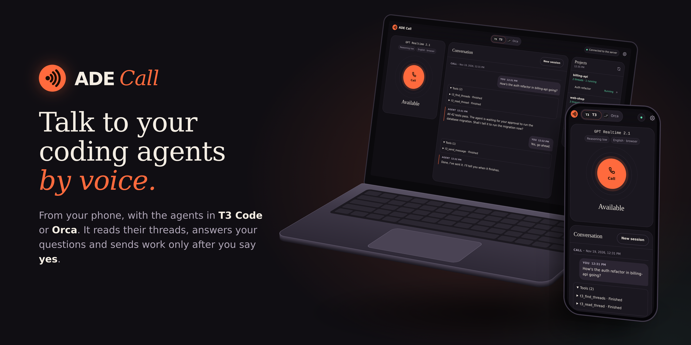

<div align="center">



# ADE Call

**Call your coding agents from your phone.**<br>
A voice line to the agents in [T3 Code](docs/t3.md) or [Orca](docs/orca.md), self-hosted on the machine where they run.

[](https://github.com/javiersgjavi/ade-call/actions/workflows/quality.yml)
[](LICENSE)


[Quick start](#quick-start) · [How it works](docs/how-it-works.md) · [Documentation](docs/README.md)

</div>

---

You leave an agent refactoring, go for a walk, and wonder whether it is stuck on a question. With ADE Call you open a page on your phone, press **Call** and ask. It reads your threads, tells you what happened and, if you want, passes the agent its next instruction.

> **You:** How's the auth refactor in billing-api going?<br>
> **ADE Call:** All 42 tests pass. The agent is waiting for your approval to run the database migration. Shall I tell it to run the migration now?<br>
> **You:** Yes, go ahead.<br>
> **ADE Call:** Done, I've sent it. I'll tell you when it finishes.

There is no text chat: the conversation is the call. The voice is OpenAI Realtime (`gpt-realtime-2.1` by default, or `gpt-realtime-2.1-mini`) or, experimentally, Google's Gemini Live (`gemini-3.8-live`) or ElevenLabs Realtime (`eleven_realtime_v1_max`), chosen in Settings, and it uses the ADE's own CLI as its tools: the voice model calls them itself. You install it on the machine where your ADE runs, and only you use it.

## What you can ask

- *"What's every agent in the web project doing?"*
- *"Read me the last message in the migration thread."*
- *"Did the subagent that wrote the tests finish?"*
- *"Tell the docs agent to also cover the new flag."*

It finds threads by the name you say out loud and reads threads, subagents and documents (T3 Code) or agent terminals (Orca) to answer.

## Why you can trust it with your agents

- **Nothing is sent without your yes.** It proposes the exact request first. The server refuses any send that does not follow something new you said, runs each send once and never retries an uncertain one automatically ([delivery safety](docs/delivery-safety.md)).
- **Your keys stay home.** With OpenAI, audio goes from the phone straight to OpenAI; with Gemini or ElevenLabs, your server relays it ([Gemini Live](docs/gemini.md), [ElevenLabs Realtime](docs/elevenlabs.md)). The keys and every action on your projects stay on your machine.
- **It keeps the record.** The conversation carries across calls, and the Conversation panel shows the transcript and every tool run.

## And a few more things

- **It tells you when the agent is done.** During the call it lets you know when an agent you just sent work to makes progress or finishes its turn (T3 Code only).
- **It answers quickly.** With T3 Code, a read-only fingerprint of the local database skips the CLI when nothing changed.
- **It speaks your language.** The voice follows whichever language you use; the interface is in English and Spanish.

See [How it works](docs/how-it-works.md) for the full path from your phone to the agents.

## What it does not do

- It is for one person. Every paired browser has full access to the owner's projects; there are no accounts or roles.
- It does not stop or cancel agents, and hanging up does not cancel work already sent.
- It cannot read or continue Orca's structured chats, or tell you when an Orca agent finishes.
- Only Linux has been tested. macOS and Windows may work, with no guarantee.
- It is not free. Every call and every message the model writes uses your OpenAI, Gemini or ElevenLabs API quota.

## Requirements

- Linux. User systemd is needed for the optional service.
- Node 24 or later, and npm.
- T3 Code with its CLI and at least one registered project ([compatibility](docs/t3.md)), or Orca with the `orca-ide` CLI.
- An OpenAI API key with access to the Realtime model, on an account with billing and credit; or, for Gemini Live, a Gemini API key from Google AI Studio with billing; or, for ElevenLabs Realtime, an ElevenLabs API key with access to Agents.
- HTTPS for phone access: browsers only allow the microphone on secure origins. Use Caddy with your own domain, or Tailscale Serve if you have no domain or cannot open ports ([Phone access](docs/deployment.md#phone-access)). Testing on the same computer works over `http://127.0.0.1`.

## Quick start

Clone into a folder you will keep, such as `~/ade-call`: the optional service runs from it.

```bash
git clone https://github.com/javiersgjavi/ade-call.git ~/ade-call
cd ~/ade-call
npm ci
npm test
```

Start the server, then pair this browser from a second terminal:

```bash
npm start
npm run access -- pair --url http://127.0.0.1:8787 --name "Laptop"
```

Open the `link` it prints and press **Pair browser**. Save your OpenAI (or Gemini or ElevenLabs) key in **Settings → API keys**, or from your terminal without echo as in [Installation](docs/installation.md#3-store-the-voice-key); either way it lands in `~/.config/ade-call/config.json`, readable only by you. Then press **Call**, allow the microphone and ask "What projects do I have?". To use it from your phone, set up the [service and HTTPS](docs/deployment.md) first. [Installation](docs/installation.md) covers each step and its checks.

## Install with a coding agent

You can give this repository to your coding agent and ask:

> Install ADE Call from https://github.com/javiersgjavi/ade-call on this machine, following its AGENTS.md. Check what you can, then ask me what you need. Set it up as a permanent service. I want to use it from my phone: help me choose between Caddy with my own domain and Tailscale Serve, and set up that route. Let me type my OpenAI key myself without it appearing in this chat, then pair my phone's browser.

[AGENTS.md](AGENTS.md) tells the agent what it may and may not do during an installation.

**Using it away from home:** ADE Call stays on the machine running your ADE. Choose public HTTPS through Caddy (a public hostname and incoming ports 80/443), or private HTTPS through Tailscale Serve (Tailscale on the machine and phone, no router port forwarding). You do not have to buy a domain: the guide also covers automatic DNS names. See [Phone access](docs/deployment.md#phone-access) for the steps, common blockers and a check over mobile data. Tailscale Serve is documented but not yet validated end to end for this project.

## Documentation

| Document | What it covers |
| --- | --- |
| [Installation](docs/installation.md) | Step-by-step setup and the first call |
| [Configuration](docs/configuration.md) | `config.json`, environment variables, directories |
| [Deployment](docs/deployment.md) | systemd service, phone access over HTTPS (Caddy or Tailscale Serve), updates, backups |
| [Access](docs/access.md) | Pairing browsers, sessions, revocation, security model |
| [Troubleshooting](docs/troubleshooting.md) | Symptoms and fixes, voice diagnostics, recovery |
| [How it works](docs/how-it-works.md) | The path of a call, reads and sends, with a diagram |
| [Architecture](docs/architecture.md) | Components and request flows |
| [Delivery safety](docs/delivery-safety.md) | When and how the voice may send a request |

The full index is in [docs/README.md](docs/README.md).

## Contributing

Contributions are welcome: code, documentation, bug reports and test results on other platforms. Read [CONTRIBUTING.md](CONTRIBUTING.md) before opening a pull request. Report security issues as described in [SECURITY.md](SECURITY.md).

## License

[MIT](LICENSE).
