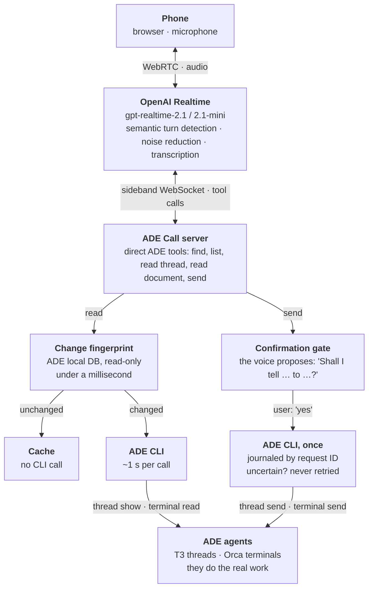

# ADE Call

ADE Call lets you talk by voice, from your phone's browser, with the coding agents running in your ADE (agentic development environment): [T3 Code](docs/t3.md) or [Orca](docs/orca.md). The voice is OpenAI Realtime (`gpt-realtime-2.1` by default, or `gpt-realtime-2.1-mini`, chosen in Settings) and it uses the ADE's tools directly. It finds and reads threads, subagents, documents and terminal output to answer your questions. When you want work done, it is instructed to propose a concrete request and send it to a thread or agent only after you say yes; the server additionally refuses any send that does not follow something new you said. There is no text chat: the conversation is the call. You install it yourself on the machine where your ADE runs, and only you use it.

## How it works



Audio goes straight from the phone to OpenAI Realtime over WebRTC; the server never relays it. The model decides when you have finished speaking and calls tools over a separate WebSocket that only the server holds, so the OpenAI key and every action on your projects stay on your machine.

Tools follow two paths. **Reads** first compare a fingerprint taken from the ADE's local database, read-only: if nothing changed since the last read, the cached answer is returned without starting the CLI; otherwise the CLI is called. (This cache exists for T3. Orca has no readable database, so its terminal reads always call the CLI and only its listings are cached for a few seconds.) **Sends** pass a gate: the voice first proposes the exact request and waits for your answer, and the server refuses a send unless you have spoken since the previous one. The send then runs through the ADE's CLI once, recorded in a journal under a request ID; if the result is uncertain it is never retried automatically. The agents in your ADE do the actual work. [Architecture](docs/architecture.md) and [delivery safety](docs/delivery-safety.md) explain each step.

## What it can do, and what it cannot

It can:

- List projects, find threads by spoken name, and read threads, subagents, documents (T3) and agent terminals (Orca).
- Send a message to an existing thread or to a project's main thread, once, after you accept a concrete proposal. Whether your words accept it is judged by the model; the server enforces the mechanical part of the [delivery safety](docs/delivery-safety.md) rules: a new user turn for each send, one send per turn, deduplication and no automatic retry of an uncertain delivery.
- Tell you during the call when an agent you just sent work to makes progress or finishes its turn (T3 only).
- Speak your language. The interface is in English and Spanish.
- Keep the conversation across calls and show the transcript and every tool run in the Conversation panel.

It cannot:

- Serve more than one person. Every paired browser has full access to the owner's projects. There are no accounts or roles.
- Stop or cancel agents. Hanging up does not cancel work that was already sent either.
- Read or continue Orca's structured chats, or notify you when an Orca agent finishes.
- Run on macOS or Windows with any guarantee. Only Linux has been tested.
- Run for free. Every call and every message the model writes uses your OpenAI API quota.

## Requirements

- Linux. User systemd is needed for the optional service.
- Node 24 or later, and npm.
- T3 Code with its CLI and at least one registered project ([compatibility](docs/t3.md)), or Orca with the `orca-ide` CLI.
- An OpenAI API key with access to the Realtime model, on an account with billing and credit.
- HTTPS for phone access: browsers only allow the microphone on secure origins. Use Caddy with your own domain, or Tailscale Serve if you have no domain or cannot open ports ([Phone access](docs/deployment.md#phone-access)). Testing on the same computer works over `http://127.0.0.1`.

## Quick start

Clone into a folder you will keep, such as `~/ade-call`: the optional service runs from it.

```bash
git clone https://github.com/javiersgjavi/ade-call.git ~/ade-call
cd ~/ade-call
npm ci
npm test
```

Start the server, then pair this browser from a second terminal:

```bash
npm start
npm run access -- pair --url http://127.0.0.1:8787 --name "Laptop"
```

Open the `link` it prints and press **Pair browser**. Save your OpenAI key in **Settings → API key**, or from your terminal without echo as in [Installation](docs/installation.md#3-store-the-openai-key); either way it lands in `~/.config/ade-call/config.json`, readable only by you. Then press **Call**, allow the microphone and ask "What projects do I have?". To use it from your phone, set up the [service and HTTPS](docs/deployment.md) first. [Installation](docs/installation.md) covers each step and its checks.

## Install with a coding agent

You can give this repository to your coding agent and ask:

> Install ADE Call from https://github.com/javiersgjavi/ade-call on this machine, following its AGENTS.md. Check what you can, then ask me what you need. Set it up as a permanent service. I want to use it from my phone: help me choose between Caddy with my own domain and Tailscale Serve, and set up that route. Let me type my OpenAI key myself without it appearing in this chat, then pair my phone's browser.

[AGENTS.md](AGENTS.md) tells the agent what it may and may not do during an installation.

**Using it away from home:** ADE Call stays on the machine running your ADE. Choose public HTTPS through Caddy (a public hostname and incoming ports 80/443), or private HTTPS through Tailscale Serve (Tailscale on the machine and phone, no router port forwarding). You do not have to buy a domain: the guide also covers automatic DNS names. See [Phone access](docs/deployment.md#phone-access) for the steps, common blockers and a check over mobile data. Tailscale Serve is documented but not yet validated end to end for this project.

## Documentation

| Document | What it covers |
| --- | --- |
| [Installation](docs/installation.md) | Step-by-step setup and the first call |
| [Configuration](docs/configuration.md) | `config.json`, environment variables, directories |
| [Deployment](docs/deployment.md) | systemd service, phone access over HTTPS (Caddy or Tailscale Serve), updates, backups |
| [Access](docs/access.md) | Pairing browsers, sessions, revocation, security model |
| [Troubleshooting](docs/troubleshooting.md) | Symptoms and fixes, voice diagnostics, recovery |
| [Architecture](docs/architecture.md) | Components and request flows |
| [Delivery safety](docs/delivery-safety.md) | When and how the voice may send a request |

The full index is in [docs/README.md](docs/README.md).

## Contributing

Contributions are welcome: code, documentation, bug reports and test results on other platforms. Read [CONTRIBUTING.md](CONTRIBUTING.md) before opening a pull request. Report security issues as described in [SECURITY.md](SECURITY.md).

## License

[MIT](LICENSE).
