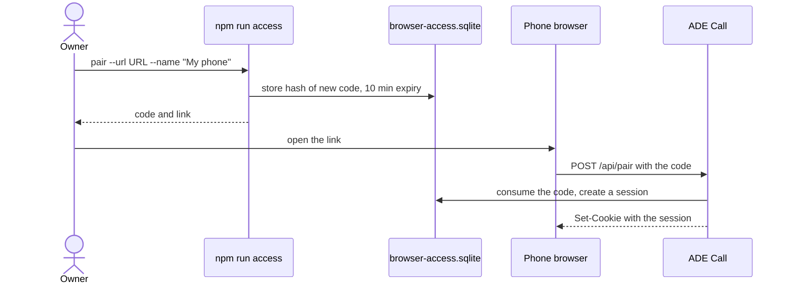

# Browser access

Every browser that uses ADE Call must be paired once with a one-time code generated on the server machine. After that, the browser keeps a long-lived session cookie. Being on the same network grants nothing: the server checks the cookie and the origin on every request.

All paired browsers have the same, full access to the owner's projects. ADE Call has no accounts, roles or separate users.

## Pairing



The owner runs the `access` command on the server machine. It stores only a hash of a fresh random code and prints the code and a link. The link carries the code in the URL fragment (`#pair=…`), which browsers never send to the server or the proxy, so the code does not end up in access logs. The page reads the fragment, removes it from the address bar and fills the form, but opening the link does not use the code: the code is consumed only when you press **Pair browser**. The server then deletes the code in the same transaction that creates the session, and returns the session as a cookie. You can also type the code by hand on the login screen.

The command does not need the server to be running, but it must use the same configuration directory:

```bash
npm run access -- pair --url https://call.example.com --name "My phone"
```

```json
{
  "code": "3F9A1C-0B7E42-D15C8A-6E20F9",
  "link": "https://call.example.com/#pair=3F9A1C-0B7E42-D15C8A-6E20F9",
  "expiresAt": "2026-01-01T12:10:00.000Z",
  "name": "My phone"
}
```

`npm run access` runs the compiled script in `dist/`; run `npm run build` first if `dist/` does not exist. Set `ADE_CALL_CONFIG` if the service uses a non-default configuration directory.

- **`--url`** is the exact address the browser will open: scheme, host and optional port, with no path, query, fragment or credentials. It must be HTTPS, except `http://localhost`, `http://127.0.0.1` or `http://[::1]` for testing on the same machine. The first `--url` becomes the installation's address. After that you can omit it; passing a different one fails rather than changing it silently.
- **`--name`** labels the browser in the list (1 to 80 characters).
- Each code has 96 random bits, works once and expires after ten minutes. At most 20 codes can be pending, and at most 100 browsers paired.

Treat a code or link like a password until it is used or expires. Do not paste it into shared logs, screenshots, commits or the voice's context. Pairing a browser does not authorize the voice to send anything to an ADE.

## Sessions

The session cookie is `HttpOnly`, `SameSite=Strict`, `Path=/` and has no `Domain`. With an HTTPS address it is named `__Host-ade_browser` and marked `Secure`; with a loopback HTTP address it is `ade_browser`. The server stores only a SHA-256 hash of each session token, in `browser-access.sqlite` in the configuration directory, so restarts keep pairings.

A session expires after **180 days without use**. Each time the page loads its status, the server renews the cookie and the 180-day period. The browser may still drop the cookie earlier: private windows, clearing site data or switching browser or profile all require a new code.

A session identifies a browser profile, not a device. There is no device binding or passkey. Anyone who copies a valid cookie can use it until it is revoked or expires. Protect the phone with a screen lock and the server's user account accordingly.

## Pair another device from the page

In **Settings → Devices**, **Pair another device** asks for a name for the other device (1–80 characters, the same rule as `--name`) and shows the link, the code and a countdown to its expiry, with **Copy link** and, where the browser offers it, **Share**. It calls `POST /api/browsers/pair` with `{"name": "My phone"}`, which needs an already paired browser sending its exact Origin, or the administrative Bearer token, and answers `code`, `link`, `expiresAt`, `expiresIn` (remaining milliseconds) and `name`.

The code is the same single-use, ten-minute credential the CLI prints, with the same cap of twenty pending codes, so send it only to yourself and keep it out of shared chats, screenshots and logs. The server does not log it. The link always uses the address already configured on the server; the request's `Host` never chooses or changes it. Until an address exists, the button answers `409` (`origin_missing`) and asks you to run `npm run access -- pair --url URL --name NAME` once on the server.

The page keeps the code only in the open panel, never in `localStorage` or the address bar, and removes it on **Done**, when Settings closes, when it expires and once the other device has used it, then refreshes the list. Hiding the panel does not cancel the code on the server: it still expires after ten minutes, and `npm run access -- cancel-codes` cancels every pending code.

## List and revoke

In the page, **Settings → Devices** lists each browser with its name and last use, and can unpair any of them. The same is available on the server, which is how you lock out a lost phone:

```bash
npm run access -- list
npm run access -- revoke --id BROWSER_ID
npm run access -- cancel-codes
```

`list` prints every browser with its `id`, `name`, `lastSeen`, `expiresAt` and `revokedAt`. `cancel-codes` deletes every pending code.

Revocation takes effect on the next request from that browser. Within a second, the server also closes its open event streams and asks OpenAI to end any call that browser started. Revoking does not undo requests already accepted, does not erase anything the browser already displayed, and does not cancel work already sent to T3 or Orca.

## Changing the address

The configured address is part of the security check, so changing it is an explicit operation on the server:

```bash
npm run access -- configure --url https://new-name.example.com
```

Changing to a different address revokes every paired browser and deletes every pending code, because cookies issued for the old origin must not keep working. Pair each browser again afterwards. The change takes effect without a restart. Typical cases are moving from `http://127.0.0.1:8787` to your HTTPS domain, or changing domain.

## Origin and proxy model

- **Before an address is configured**, the page and pairing work only over loopback HTTP: the `Host` header must be `localhost`, `127.0.0.1` or `[::1]` and the TCP peer must be a loopback address.
- **After it is configured**, the server accepts a session cookie only when the request's `Host` header matches the configured host and port.
- Every request that changes something (any method other than `GET`) from a browser must carry an `Origin` header equal to the configured origin. Requests without a matching origin get `403`.
- The audio WebSocket of a [Gemini Live](gemini.md) call (`/api/live/stream`) needs the same cookie or bearer token, an `Origin` equal to the configured origin (or the bearer token when there is none), and the call must belong to that browser or token; it attaches once.
- Pairing attempts are limited to 20 per minute per TCP peer. Behind a proxy, all clients share the proxy's address and therefore one budget. This is deliberate: the server does not trust `X-Forwarded-For`.
- `X-Forwarded-Proto`, `X-Forwarded-Host` and client IP addresses are never used to grant access.

This means the proxy must preserve `Host`, TLS must terminate at a proxy you control, and the backend port must not be reachable directly. Configuring an HTTPS address does not install a certificate or verify any of this; see [Deployment](deployment.md#https-reverse-proxy).

## Administrative token

On first start the server writes a random token to `access-token` in the configuration directory (mode `600`). Local tools can authenticate with `Authorization: Bearer <token>`; such requests skip the browser origin check. The token is not a pairing code and not an OpenAI key, and the page does not offer it as a sign-in method. It is kept across restarts. Treat it as a root credential for this installation; to rotate it, stop the server, delete the file and start again.

## What this does not protect against

- Someone with a copied, unexpired session cookie or the administrative token.
- Someone with access to your user account on the server: the configuration directory holds the key, the token and the pairing database.
- A misconfigured proxy that exposes the backend port or rewrites `Host`.
- Anything OpenAI receives: call audio and whatever the tools read to answer you.

The long session lifetime is a deliberate choice for a single-owner tool used from a phone, not a general recommendation. Background reading: [OWASP session management](https://cheatsheetseries.owasp.org/cheatsheets/Session_Management_Cheat_Sheet.html).
