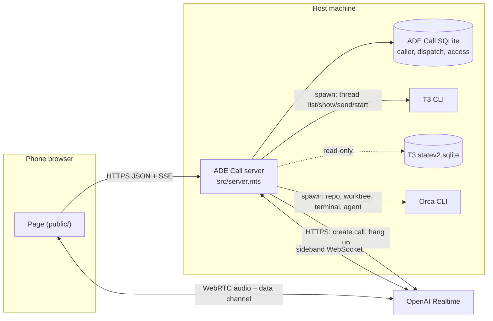
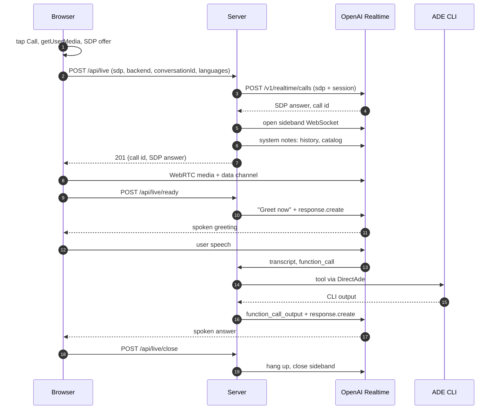
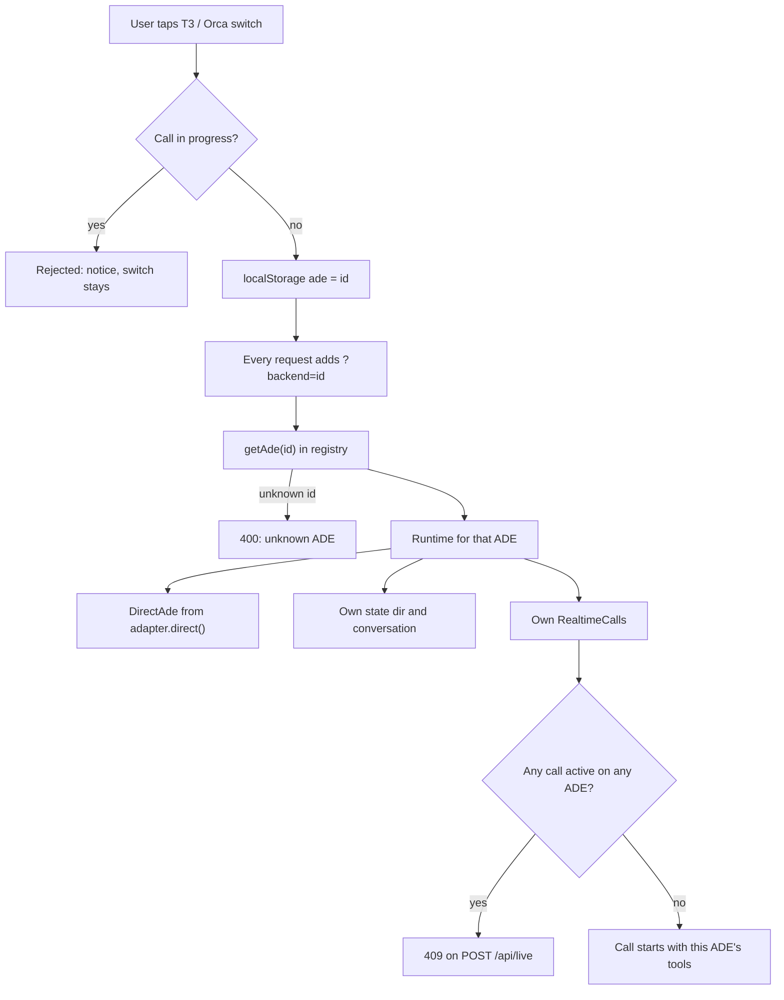

# Architecture

ADE Call is a single Node.js process that lets you talk, by voice, to
the coding agents of an Agentic Development Environment (ADE) running on the
same machine. Two ADEs are supported: [T3 Code](t3.md) and [Orca](orca.md). The
browser carries the audio straight to OpenAI Realtime; the server owns
everything that touches your projects: it builds the session, runs the tools
the model calls, enforces the send rule and keeps the records.

The [diagram in How it works](how-it-works.md) shows the
whole path at a glance. This page is the entry point for contributors. The
details live in:

- [voice.md](voice.md): session setup, prompt assembly, turns, interruptions, notices.
- [delivery-safety.md](delivery-safety.md): the send rule, deduplication and uncertain deliveries.
- [adapters.md](adapters.md): the `DirectAde` contract and how to add an ADE.
- [t3.md](t3.md) and [orca.md](orca.md): what each adapter reads and runs.
- [access.md](access.md): pairing, sessions and the origin check.

## Components

There are three kinds of links, and keeping them apart is the core of the
design.

**Audio** goes over WebRTC directly between the browser and OpenAI. The server
never relays audio, so a slow host or a reverse proxy does not add latency to
speech. The WebRTC connection also carries a data channel (`oai-events`) that
the page uses to learn when the line is live and to send `session.close` on
hang-up.

**Control** goes over a sideband WebSocket that the server opens to the same
OpenAI call (`wss://api.openai.com/v1/realtime?call_id=…`). Every tool call,
tool result, system note and `response.create` travels here. Because the
browser has no part in this channel, the page cannot run a tool or bypass the
server's send checks; tool calls are executed only from what the server
receives on the sideband.

With a Gemini model the call runs on [Gemini Live](gemini.md), which has no
WebRTC leg and no sideband. The server opens the provider WebSocket itself and
relays the audio over a second, authenticated WebSocket to the page
(`/api/live/stream`): audio does pass through the server then, and tool calls
still arrive only on the server's socket. [Lokutor](lokutor.md) uses the same relay.

**Application traffic** between the page and the server is plain HTTPS: JSON
requests for status, projects and call lifecycle, and one Server-Sent Events
stream (`/api/events`) for transcripts, tool runs and notices. Every request is
authenticated (bearer token or paired-browser cookie) and state-changing
requests must come from the configured origin; see [access.md](access.md).

The OpenAI key stays on the server. The browser sends its SDP offer to
`POST /api/live`; the server forwards it with the session configuration to
`POST /v1/realtime/calls` and returns only the SDP answer and the call ID.

The server changes the ADEs only through their CLIs (`T3_BIN`, `ORCA_BIN`). It
reads T3's local SQLite projection with `readOnly: true` for fast catalogs,
search and cache fingerprints, and never writes to it. Orca has no database
access at all: everything goes through `orca-ide … --json`.

## A call, end to end

1–4. The page asks for the microphone, gathers ICE candidates and posts the
offer. The server refuses with `409` if another call is active or connecting
(on any ADE), if the service is shutting down, or if the `backend` or
`conversationId` in the body no longer match the server's view. It then
creates the call with the session built in
[`RealtimeCalls.session()`](../src/voice/realtime.mts): instructions, tools,
voice, semantic VAD and transcription settings ([voice.md](voice.md#session-setup)).

5–7. Before answering the browser, the server attaches the sideband socket and
injects two silent system messages: the resume of the conversation and the
ADE's compact catalog with short IDs. If the sideband cannot connect, the
server hangs the provider call up and the request fails, so there is never a
call the server cannot control.

8–11. Once WebRTC is connected, the page plays the "connected" tone and posts
`/api/live/ready`. Only then does the server ask the model to greet, so the
greeting is not lost while audio is still being negotiated.

12–17. OpenAI's semantic VAD decides when the user's turn ends and the model
answers or calls a tool. The server receives `response.output_item.done` for
each function call and hands it to [`DirectSession.run()`](../src/direct/session.mts),
which runs it at most once per `call_id`, applies the send rule to sending
tools and calls the `DirectTool.execute()` of the active ADE. The ADE runs its
CLI and returns plain text. The server adds the output to the conversation and
requests one spoken answer once every pending function call of that response
has an output. Each run is also stored and streamed to the page as a
`voice-tool` event.

18–19. Hanging up closes the local media immediately, then posts
`/api/live/close`. The server hangs up the provider call and closes the
sideband. The call also ends if the data channel or peer connection closes, if
the provider closes the sideband, or if the server has not received a
heartbeat (sent every 10 s) for 45 s. When the sideband closes, the server
also asks the provider to hang up the call itself, without waiting for the
page to see the notice: with no sideband no tool can run. Stopping the service
closes every call; a call the provider creates while the service stops, or
whose sideband is still connecting, is hung up once, without being opened or
announced. The hang-up starts as soon as the provider's success headers name
the call, without waiting for the rest of its answer. If the connection breaks
while the server reads that answer, the server still hangs the call up.

Hanging up never cancels ADE work. A tool that is already executing when the
call closes runs to completion; a delivery it confirms is still followed for
notices. A send whose authorizing transcript had not arrived yet is abandoned
without running. See [delivery-safety.md](delivery-safety.md#hanging-up).

## Choosing the active ADE

The [registry](../src/adapters/registry.mts) is a frozen map of ADE
definitions: name, theme, capabilities, catalog and overview reads, state
location and an optional `direct()` factory that returns the
[`DirectAde`](adapters.md) the voice engine runs. At startup the server builds
one runtime per entry: a `ProjectContext`, a `Discovery`, a `RealtimeCalls`
engine bound to that ADE's `DirectAde`, and, for ADEs that can read thread
messages (T3 today), a `ThreadWatch` for notices.

The page remembers the chosen ADE in `localStorage` and appends
`?backend=t3|orca` to every request; without the parameter the server uses
T3. There is no mutable server-wide "current ADE": each request names its
runtime, and request bodies that start or reset calls also carry `backend` and
`conversationId`, which the server checks against its own state. The page
refuses to switch while a call is active, and discards responses that arrive
for a view it has already left.

Only one call runs at a time across all ADEs (`voiceBusy()` in the server).
Each ADE has its own conversation (`conversation:<id>` in `caller.sqlite`),
and its own state directory, `ades/<id>/` (`ades/t3/`, `ades/orca/`). A failure of one ADE's CLI never activates the other.
An ADE without `direct()` has no voice: `/api/status` reports
`direct: false` and `POST /api/live` answers `409`.

## HTTP endpoints

All under the same origin; everything except static assets and `/api/pair`
requires authentication. ADE-scoped endpoints take `?backend=`.

| Endpoint | Purpose |
| --- | --- |
| `POST /api/pair` | Redeem a pairing code for a browser cookie ([access.md](access.md)) |
| `GET /api/browsers`, `POST /api/browsers/revoke`, `POST /api/logout` | List and revoke paired browsers |
| `GET /api/status` | ADEs, availability, conversation, voice settings, event cursor |
| `GET /api/projects?progressive=1` | Project and activity overview, polled until discovery completes |
| `GET /api/context` | Refreshes and returns the server's snapshot of projects and tracked threads |
| `GET /api/calls?through=N` | Transcript and tool events of the current conversation, up to cursor N |
| `GET /api/events` | SSE stream of every stored event after `Last-Event-ID` |
| `POST /api/conversation/new` | Start a new conversation (refused during a call) |
| `POST /api/live` | Create a call from an SDP offer |
| `POST /api/live/ready`, `/heartbeat`, `/close`, `/interrupt` | Call lifecycle; heartbeats carry audio diagnostics |
| `GET /api/recordings`, `POST /api/recordings/part` | Optional diagnostic recordings ([troubleshooting.md](troubleshooting.md)) |

## Data stores

`$CONFIG` is `ADE_CALL_CONFIG` (default `~/.config/ade-call`) and
`$STATE` is `ADE_CALL_STATE` (default `~/.local/share/ade-call`).
Directories are created `0700` and databases `0600`. See
[configuration.md](configuration.md) for every variable.

| File | Owner | Contents |
| --- | --- | --- |
| `$CONFIG/config.json` | operator | OpenAI key and Realtime settings |
| `$CONFIG/access-token` | [server](../src/server.mts) | Admin bearer token, generated on first start |
| `$CONFIG/browser-access.sqlite` | [access/browsers.mts](../src/access/browsers.mts) | Configured origin, hashed pairing codes and browser tokens, login rate limits |
| `$STATE/caller.sqlite` | [conversation/store.mts](../src/conversation/store.mts) | `events` (transcripts, voice lifecycle, tool runs, notices, diagnostics) and `meta` (current conversation and last call per ADE, usage, context at last close) |
| `$STATE/ades/t3/dispatch.sqlite` | [t3/coordinator.mts](../src/adapters/t3/coordinator.mts) | T3 send journal (`dispatches`), main thread per project, followed threads |
| `$STATE/ades/t3/tracked-threads.json` | T3 coordinator | Main and followed threads, read back into the context snapshot |
| `$STATE/ades/orca/dispatch.sqlite` | [orca/dispatch.mts](../src/adapters/orca/dispatch.mts) | Orca send and launch journal (`operations`) |
| `$STATE/recordings/<id>/` | [voice/recordings.mts](../src/voice/recordings.mts) | Optional diagnostic recordings: audio, timeline, manifest |
| `$T3CODE_HOME/userdata/statev2.sqlite` | T3 | T3's own projection; ADE Call opens it read-only |

The journals are the durable record of what was sent. Never delete them to
"unstick" a project; see [delivery-safety.md](delivery-safety.md).

## Code map

| Path | Responsibility |
| --- | --- |
| [src/server.mts](../src/server.mts) | HTTP routes, authentication and origin checks, runtimes per ADE, SSE, shutdown |
| [src/access/](../src/access/browsers.mts) | Browser pairing, sessions, revocation |
| [src/adapters/registry.mts](../src/adapters/registry.mts) | ADE definitions and capabilities |
| [src/adapters/discovery.mts](../src/adapters/discovery.mts) | Shared, progressive project overview for the page |
| [src/adapters/documents.mts](../src/adapters/documents.mts) | Bounded reads of project Markdown and text files |
| [src/adapters/t3/](../src/adapters/t3/client.mts) | T3 CLI and read-only SQLite access, read cache, send journal, formatting |
| [src/adapters/orca/](../src/adapters/orca/client.mts) | Orca CLI access, send journal, formatting |
| [src/direct/contract.mts](../src/direct/contract.mts) | The `DirectAde` / `DirectTool` contract |
| [src/direct/session.mts](../src/direct/session.mts) | ADE-agnostic tool execution and the send rule |
| [src/direct/state.mts](../src/direct/state.mts) | Per-call short IDs and read memory |
| [src/direct/prompt.mts](../src/direct/prompt.mts) | Session instructions from `resources/` |
| [src/direct/t3.mts](../src/direct/t3.mts), [src/direct/orca.mts](../src/direct/orca.mts) | Each ADE's catalog, tools and prompt parts |
| [src/voice/realtime.mts](../src/voice/realtime.mts) | OpenAI Realtime call creation, sideband events, turn ordering, speaking queue |
| [src/voice/recordings.mts](../src/voice/recordings.mts), [diagnostics.mts](../src/voice/diagnostics.mts) | Diagnostic recordings and audio metrics |
| [src/conversation/](../src/conversation/store.mts) | Event store, context and resume text, thread watch, recognition vocabulary |
| [src/resources.mts](../src/resources.mts), [resources/](../resources/README.md) | Model-facing text: prompts, tool schemas, errors |
| [public/](../public/app.ts) | Page: call control, WebRTC, tones, transcript panel, settings, i18n |
| [scripts/](../scripts/check.mts) | Build, checks, installer, access CLI, replay and measurement tools |
| [deploy/](../deploy/Caddyfile.example) | Reverse proxy example and optional project sync units |
| [test/](testing.md) | Local tests with simulated providers and CLIs |

`public/` is TypeScript compiled into `dist/public/` by `npm run build`; the
server serves only an allowlist of compiled files.

## Invariants

These hold across the codebase. Each is explained once, where linked.

- ADE state changes only through the ADE's CLI; T3's database is read-only.
- A sending tool runs only for a new transcribed user turn (an echo of the
  recognition hints is not one), at most once per `call_id`, and is never retried ([delivery-safety.md](delivery-safety.md)).
- A send that may have happened is recorded as uncertain and blocks the project
  until it is resolved ([delivery-safety.md](delivery-safety.md#uncertain-deliveries)).
- Hanging up does not cancel ADE work.
- The voice engine (`src/voice/realtime.mts` and the `contract`, `session`,
  `state` and `prompt` modules of `src/direct/`) imports no T3 or Orca code; a
  test in `test/realtime.test.mts` enforces it ([adapters.md](adapters.md)).
- Text that comes from threads, terminals, documents or history is data for
  the model, never instructions or authorization.
