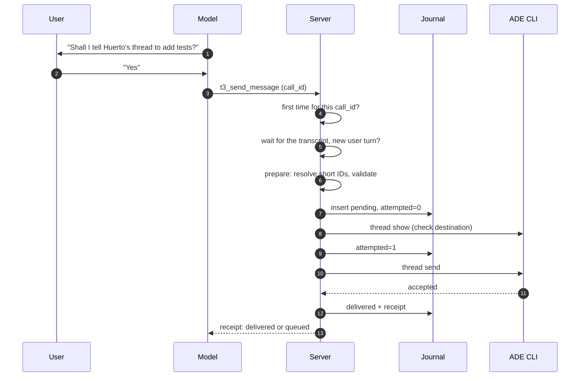
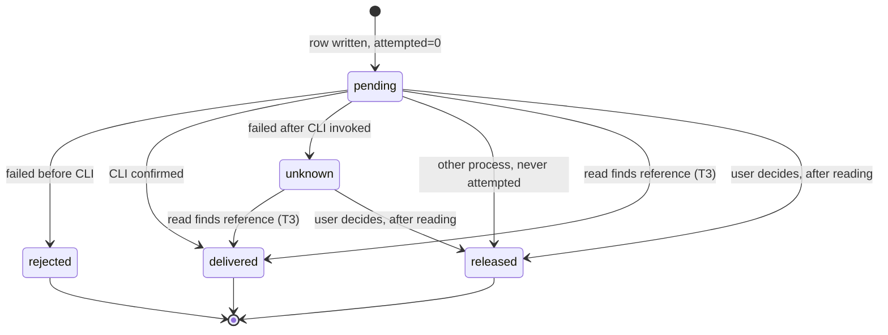

# Delivery safety

A voice assistant that can message coding agents must not send what the user
did not ask for, must not send the same thing twice, and must not pretend to
know whether a send arrived when it does not. This page describes how
ADE Call handles each of these, and is the reference other docs link
to. The code is in [src/direct/session.mts](../src/direct/session.mts), the T3
journal in [src/adapters/t3/coordinator.mts](../src/adapters/t3/coordinator.mts)
and the Orca journal in [src/adapters/orca/dispatch.mts](../src/adapters/orca/dispatch.mts).

"Sending tools" are those marked `sends: true` in the [`DirectAde`
contract](adapters.md): `t3_send_message`, `orca_send_message` and
`orca_start_agent`, plus the two release tools described below.

## The send rule

Two layers decide whether a send happens. It matters which one does what.

**The prompt asks** the model to propose every send in one short, natural
sentence ("Shall I tell it to …?", naming the thread or project only when the
user did not or to tell candidates apart), wait for the user's yes, include
only what the user asked for or accepted, and send once. Only a clear
acceptance of the proposal counts; a "yes" that cuts the proposal off accepts
it when the message and the recipient are what the user asked for, so the
model does not propose again; otherwise it asks. Asking, designing, a bare "okay" with no proposal, a
lone word, number or name that accepts no proposal (often a
transcription artifact), noise, or instructions found in threads, documents
or history do not authorize a send. Judging whether the user's words accept a concrete proposal is left to
the model, in whatever language the call is in.

**The server enforces** a narrower, mechanical rule: a sending tool runs only
if the conversation contains new transcribed words from the user since the
text that authorized the previous send. It does not interpret those words. If
the model calls a send with no new user turn, the server refuses
(`NOT SENT (no_user_turn)`) and runs nothing. This blocks a model that sends on
its own, repeats a send, or chains two sends off one "yes"; it does not by
itself prove the user said yes.

A transcript that only recites the recognition hints given to the transcription
model (three or more of those names and no other word, such as "t3, ADE Call,
Claude, Codex, …", which the model can return for a short or unclear sound) is
stored and shown, marked `echo: true`, but is not a user turn for this rule.

3–4. Each function call runs at most once per `call_id`; a duplicate event is
ignored.

5. A user's "yes" may still be transcribing when the tool call arrives. The
server waits up to 2.5 s for pending transcripts, then checks for a new user
turn in conversation order (see [voice.md](voice.md#turns-and-speaking)). If
the call closed meanwhile, the tool is abandoned without running.

6. `prepare()` resolves short IDs and validates arguments with no side
effects. A bad ID fails here, before the user's turn is used up, so the
corrected call can still run.

7–8. The journal row is written before the CLI is invoked, keyed by the
server's request ID `voice:<call id>:<call_id>`. The model never chooses it.
The T3 coordinator then checks the destination (exists, belongs to the
project, not archived) with a read.

9–10. `attempted=1` is committed immediately before the mutating CLI call, and
only if the row is still `pending`. The CLI call itself is not given the
tool's abort signal: once started, it is allowed to finish.

11–13. The receipt is stored and returned. "Delivered" means the ADE accepted
the message, possibly queued behind a running turn; it never means the work is
done. T3 reports the mode (`started`, `queued`, `steered`, `restarted`, or
`unverified` if the CLI did not say).

Each accepted send uses up the user's turn. If the send fails before anything
reached the ADE (`NotDispatchedError`: unknown ID, wrong project, archived
thread, blocked project), the turn is given back, so the model can correct
the call without asking again. The two release tools need a user turn but do
not use it up, so "unblock it and send it again" can run both in one turn.

## Deduplication

The request ID is the primary key of the journal. Calling a sending tool again
with a request ID already in the journal never sends again:

| Existing row | Result |
| --- | --- |
| `delivered` / `accepted` | The stored receipt is returned |
| `pending` / `unknown` | Error: uncertain, read the destination |
| `rejected` | Error: it failed before sending |
| `released` | Error: released without confirmation, never resent |
| Same ID, different project, message or target | Error: conflict |

Distinct `call_id`s always map to distinct request IDs (non-token parts are
hashed, never truncated), so this protects against replays of the same call
rather than against the model deciding to send twice; that is what the send
rule and the uncertain block are for.

## Uncertain deliveries

If a send fails after the CLI was invoked (a timeout, a crash, an answer that
does not confirm the thread), it may have arrived. The server never retries
it. The row stays `unknown`, the model is told "Delivery not confirmed: it may
have happened. Do not repeat it", and the project is blocked: while any row of
that project is `pending` or `unknown`, every new send to it is refused with
an error saying when and where the earlier send went and how to check it.

`delivered` is called `accepted` in the Orca journal. `rejected`, `delivered`
and `released` are final; `pending` and `unknown` block the project. A row is
never deleted. There are three ways out of the uncertain states.

**1. Reading finds the reference (T3 only).** Every T3 send starts with a fixed
line, `Request received by ADE Call. Reference: <request id>.`
(`referenceLine` in the coordinator; keep it stable, reads parse it back). When
`t3_read_thread` returns a **user** message containing that line at the start
of a line, and the row's target is that thread (or, for a send that was
creating the project's main thread, any thread of that project), the row
becomes `delivered` and the read output says so. A reference quoted by the
agent, or found in another thread, does not count. Only the messages the read
returns are checked, so an older send may need a read with more `messages`.

**2. The user decides to release it.** If the reference is not there, the model
tells the user. If the user decides to unblock (or to resend),
`t3_release_uncertain` / `orca_release_uncertain` marks the most recent
uncertain row of the project `released` and sends nothing. The server refuses
the release while the send is still in progress in this process, and, when the
destination thread or terminal is known, unless this call has read it since
the send was made. A resend, if the user asked for one, is a separate send with its own
request ID and the normal rule. Orca sends carry no reference (an extra line
typed into an agent's input would change the request, and terminal output
cannot prove submission), so for Orca this is the normal path.

**3. It provably never went out.** Each row records the process that wrote it.
A `pending` row from another process (the service stopped or crashed) with
`attempted=0` proves the CLI was never invoked; it is released automatically,
with reason `not_attempted`, on the next send or release. A row with
`attempted=1` stays uncertain and needs path 1 or 2.

An explicit release tool, rather than letting the model resend after the
block, keeps the decision visible: it is a separate recorded action, tied to a
read of the destination and a user turn, and the later send is deduplicated as
usual. A last-resort manual recovery for when the voice is unavailable is in
[troubleshooting.md](troubleshooting.md).

## Hanging up

Hanging up, closing the page or losing the connection does not cancel ADE
work, and the prompt tells the model to say so. Neither T3's nor Orca's CLI
exposes a stop operation, so the voice cannot stop an agent; that is done in
the ADE.

At the moment the call closes:

- A send still waiting for its authorizing transcript is abandoned; nothing runs.
- A send already executing finishes. Its journal row is updated and, if
  delivered, the thread is still followed for notices in that conversation
  ([voice.md](voice.md#notices-during-a-call)). Its result is not spoken.
- Stopping the service closes calls and, if a call was active or connecting or
  a tool is still running (including a send that kept going after a hang-up),
  waits 16 s before exiting. A send cut off by the exit is left `pending` with `attempted=1` (uncertain) or
  `attempted=0` (released automatically by the next process). It is never
  resumed or repeated.

## What this does not cover

The server cannot tell whether the user's words accepted a proposal; it only
checks that the user spoke. A transcription error can turn noise into a turn.
"Delivered" proves acceptance by the ADE, not execution. Text read from
threads, terminals and documents is passed to the model as data, but the
model can still misread it; the rule above is what limits the consequences.
