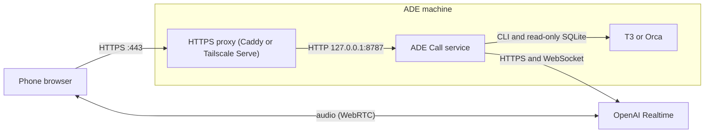

# Deployment

A permanent installation runs ADE Call as a systemd user service on the ADE's machine, behind an HTTPS proxy so your phone can reach it. Complete the [Installation](installation.md) first, including the OpenAI key, from a checkout in a permanent folder: the service runs from it.



The phone only talks to two places: the proxy, for the page, pairing, API calls and the event stream, and OpenAI, for the call's audio. The proxy terminates TLS and forwards plain HTTP to ADE Call, which listens on loopback by default and is not reachable from the network on its own. ADE Call runs the ADE's CLI as the same user, so T3 or Orca must be installed and running on the same machine. It also needs outbound access to `api.openai.com` to create calls and run the voice's tool calls, or to `generativelanguage.googleapis.com` with a [Gemini Live](gemini.md) model, or to `api.lokutor.com` with [Lokutor](lokutor.md). With Gemini or Lokutor there is no WebRTC leg: the phone's audio goes through the proxy to ADE Call over a WebSocket (`/api/live/stream`). Caddy's `reverse_proxy` and Tailscale Serve forward WebSockets as they are; another proxy must allow the upgrade.

## Run as a systemd user service

On Linux with user systemd, after `config.json` contains the key:

```bash
bash scripts/install-user.sh
```

The installer:

1. Finds `node` and checks Node 24+ (set `NODE_BIN` to override it), and at least one ADE CLI: `t3` on `PATH` or in `~/.local/bin/t3` (`T3_BIN` to override). Without T3 it installs for Orca only, if `ORCA_BIN` is set or `orca-ide` is on `PATH`, and says so; T3 then shows as unavailable. A `T3_BIN` that does not exist is an error, not an Orca-only installation. With no ADE CLI it stops before building anything.
2. Runs `npm ci --include=dev` and `npm run build`.
3. Writes `~/.config/systemd/user/ade-call.service` and enables and starts it.
4. If the service was already running, restarts it so the new unit and build take effect. First it asks the running service, with the administrator token, whether it is in use (`serviceBusy` in `/api/status`: a call active or connecting, or a tool such as a send still running). It asks the process that is running, at the `ADE_CALL_HOST` and `PORT` and with the token of the `ADE_CALL_CONFIG` in that process's environment (`/proc/<MainPID>/environ`), never the values exported for the new installation. The token is only sent once the listening TCP socket on that port is one of the main process's own descriptors (`/proc/net/tcp`, `/proc/net/tcp6` and `/proc/<MainPID>/fd`), and only to that socket's IP address, without resolving `ADE_CALL_HOST` again; a wildcard listener is asked through loopback. If another process holds the port, for example while the service is starting and has not opened its socket yet, nothing is sent and the answer is unknown. If the service is in use, the installer checks again every 5 seconds and restarts as soon as it is free, for at most 2 minutes on a monotonic clock: each pause and each request (5 seconds at most) is cut to the time left. If it is still in use after that, or the answer is unknown, it restarts anyway and prints a warning (see [Accepted restart risks](#accepted-restart-risks)).

The unit's `WorkingDirectory` is the checkout you ran the installer from and its `ExecStart` runs `dist/src/server.mjs` inside it, so keep that folder where it is: moving or deleting it breaks the service. If you move it, run the installer again from the new place. The unit runs the compiled file directly, so the service does not rebuild on start. It captures these variables from your shell at install time: `T3CODE_HOME`, `ADE_CALL_STATE`, `ADE_CALL_CONFIG`, `ADE_CALL_HOST`, `PORT`, `PATH` with Node's directory in front, `T3_BIN` when T3 was found, and `ORCA_BIN` and `ADE_CALL_TIME_ZONE` when they are set. It never writes the OpenAI key into the unit. To change any of them, export the new value and run the installer again. The installer does not install or start T3 or Orca.

```bash
systemctl --user status ade-call
journalctl --user -u ade-call -n 50
systemctl --user restart ade-call
systemctl --user stop ade-call
```

To keep the service running while you are logged out, enable lingering for your user: `loginctl enable-linger "$USER"`.

On stop, the server closes active calls and, if a call or a tool was still running, waits 16 seconds for them to wind down. A tool call cut short by a restart is left without a confirmed result and is never resumed or repeated; see [Delivery safety](delivery-safety.md).

### Accepted restart risks

Re-running the installer always ends with the new installation running; it does not leave the restart to you. That has two accepted risks:

- Something can start between the last check and the restart, for example a call that connects just before it. The restart ends it.
- The service is restarted even when it reports being in use after the wait, or when it cannot be asked: no main process, its environment cannot be read, no token in its configuration, its listening socket not owned by its main process (or `/proc` unavailable to check it), no answer at its address, or a version too old to report `serviceBusy`. The installer prints a warning in both cases.

A restart ends the calls in progress. A tool cut short is left without a confirmed result and is never resumed or repeated ([Delivery safety](delivery-safety.md)); on stop the server waits for running tools as described above. To avoid both risks, run the installer when you know nobody is on a call.

## Phone access

**Access from outside your home network is supported.** ADE Call stays on the Linux machine where T3 or Orca runs; that machine must remain on and connected. Installing the service or generating a pairing link does not publish it on the Internet. You also need a network route to it and HTTPS for the phone's microphone, even when the phone is on your Wi-Fi.

Choose based on how you want to connect:

- **Open the URL in an ordinary phone browser, without a VPN app:** use Caddy with a public hostname and incoming ports 80/443. You can use your own domain or the [automatic DNS option](#without-your-own-domain).
- **Avoid opening router ports, or connect through carrier-grade NAT (CGNAT):** use Tailscale Serve. Install Tailscale on both the server and the phone and join the same private network (tailnet). It works away from home too; the URL is private to your tailnet. This project's setup is documented but not yet validated end to end.

The two routes have different requirements:

| | [Caddy with a public hostname](#https-reverse-proxy) | [Tailscale Serve](#tailscale-serve) |
| --- | --- | --- |
| You need | A hostname pointing to your public IP (your own domain or automatic DNS), and ports 80 and 443 reachable from the Internet | A Tailscale account, with MagicDNS and HTTPS certificates enabled |
| On the phone | Nothing | The Tailscale app, connected to the same tailnet |
| Who can reach the page | Anyone on the Internet; pairing still gates access | Only devices in your tailnet; pairing still gates access |
| Address to pair with | `https://call.example.com` | `https://<machine>.<tailnet>.ts.net` |
| Status | Example configuration in [`deploy/`](../deploy/Caddyfile.example) | Documented, not yet validated end to end |

Pick Tailscale if you have no domain, cannot open ports (for example behind carrier-grade NAT) or prefer the page to be invisible from the Internet. Either way, pair the phone against the HTTPS address afterwards; see [Access](access.md).

### What the installer and your agent do

`scripts/install-user.sh` builds ADE Call and installs its user service. It does not install a proxy, create DNS records, open router ports or configure Tailscale. `access pair --url` records the address and generates a browser credential; it does not make that address reachable.

An installation agent should inspect existing services and proxies, explain which route fits, and carry out the route you authorize. Remote access is an intended deployment, not a reason to refuse installation. A missing domain alone is not a blocker. If a step needs access the agent lacks, such as your router's administration page, it should give you the exact change needed and continue the independent setup work. Your approval of a specific network change need not be requested again for that same change.

### Public access from a home connection

For the Caddy route, the request travels from the phone over the Internet to your router, then to Caddy on the ADE machine, and finally to ADE Call's internal HTTP port.

1. Check whether the connection accepts inbound traffic. With CGNAT, forwarding ports on your own router is not enough: use Tailscale Serve or ask your ISP for a public address. If another router sits in front of yours, forwarding may be needed on both.
2. Give the ADE machine a stable LAN address, for example with a DHCP reservation. Forward **TCP 80 to TCP 80** and **TCP 443 to TCP 443** at that address, and allow those ports through the host firewall. Forward them to Caddy, not directly to ADE Call. On a hosted Linux machine, configure the equivalent inbound firewall rules instead.
3. Point the chosen hostname at the public address. Use an `A` record for IPv4; only add an `AAAA` record if IPv6 actually reaches Caddy. If the public IP changes, update the DNS record, for example through your DNS provider's dynamic DNS support.
4. Configure [Caddy](#https-reverse-proxy) to forward that hostname to ADE Call. Reuse an existing proxy on ports 80/443 instead of starting a competing one. If it runs in Docker, follow [Caddy in a container](#caddy-in-a-container).
5. Configure ADE Call's HTTPS address and pair the phone as described under [Verify access from outside](#verify-access-from-outside).

The owner chooses the route and authorizes changes to their DNS, router, firewall and proxy. An agent should prepare the exact records, port mappings and proxy block before asking for any missing approval.

### Without your own domain

[sslip.io](https://sslip.io/) provides DNS names that resolve to the IP address embedded in them. For example, `call.203-0-113-10.sslip.io` resolves to `203.0.113.10` (a documentation-only address: replace it with your actual public IPv4 address). Use the resulting hostname in the Caddy block and its `https://` URL when pairing.

This avoids buying a domain or creating DNS records. It is DNS, not a tunnel: you still need a reachable public IP, incoming ports and a valid HTTPS certificate from Caddy. It depends on an external DNS service. If your public IP changes, the hostname changes too, requiring a Caddy update and an [address change](access.md#changing-the-address) that revokes existing pairings. A domain you control is more convenient for a lasting address.

### Verify access from outside

Use the same `ADE_CALL_CONFIG` as the running service for these commands. Replace the example URL with the HTTPS address of your chosen route.

1. If you already configured a local address, switch it first with `npm run access -- configure --url https://call.example.com`. **This revokes existing browser pairings and pending codes.** Skip this command on a fresh installation or if the configured address is already correct.
2. Run `npm run access -- pair --url https://call.example.com --name "Phone"`. Share the generated link only with the owner.
3. Turn off Wi-Fi on the phone and open the link using mobile data. For Tailscale Serve, keep the Tailscale connection enabled. Confirm HTTPS has no certificate warning, pair the browser and check that projects appear.
4. This verifies remote page access and authenticated reads. Test voice only if the owner requests a paid call; ask a read-only question and do not send work as a test.

If nobody has tested from an outside connection, report that remote reachability is still unverified. Loading the page from the server or home Wi-Fi does not prove it works from elsewhere.

| Symptom | Check next |
| --- | --- |
| Hostname does not resolve | DNS record or the public IP embedded in the automatic hostname. For Serve, the phone's Tailscale connection and MagicDNS. |
| Connection times out | Router forwarding, host firewall, CGNAT, or the machine being asleep. For Serve, both devices must be connected and tailnet access rules must allow the connection. |
| Certificate warning | The hostname and Caddy's certificate issuance; do not bypass the warning. |
| Proxy returns `502` | Whether ADE Call is running and the proxy can reach its internal address, especially from Docker. |
| Page loads but pairing or API requests return `403` | The configured URL must match the browser's scheme, host and port, and the proxy must preserve `Host`. |
| Public URL works on mobile data but not home Wi-Fi | The router may lack NAT loopback; use suitable local DNS or the private Tailscale route. |

## HTTPS reverse proxy

[`deploy/Caddyfile.example`](../deploy/Caddyfile.example) is a starting point for [Caddy](https://caddyserver.com/), which obtains certificates automatically:

```caddyfile
call.example.com {
    encode gzip
    header Strict-Transport-Security "max-age=31536000"
    header -Server
    reverse_proxy 127.0.0.1:8787 {
        flush_interval -1
    }
}
```

Replace `call.example.com` with your domain and merge the block into your existing Caddy configuration. For Caddy to obtain the certificate:

- The domain (or a subdomain) needs an `A`/`AAAA` DNS record pointing to this machine's public address.
- Ports 80 and 443 must be reachable from the Internet. At home, forward both ports on the router to this machine. Caddy answers the certificate challenge on them, and the phone uses 443.
- Caddy must be installed and running as a service; see [Caddy's install guide](https://caddyserver.com/docs/install).

If any of these is not possible, use [Tailscale Serve](#tailscale-serve) instead.

Any proxy works if it meets three conditions:

- It forwards the original `Host` header unchanged. ADE Call compares it with the configured address.
- It does not buffer `text/event-stream` responses. `flush_interval -1` does this in Caddy; the server also sends `X-Accel-Buffering: no` for nginx.
- It is the only way in. The backend port must not be reachable from the Internet.

ADE Call does not read `X-Forwarded-*` headers or client IPs for access decisions, so the proxy does not need to set them. Keep your ADE's own ports private as well.

Then pair your phone against the HTTPS address. If you first paired with `http://127.0.0.1:8787`, switching the address revokes earlier pairings; see [Access](access.md#changing-the-address).

### Caddy in a container

If Caddy runs in a container, `127.0.0.1` inside it is the container, not the host. Make ADE Call listen on an address the container can reach (for example the Docker bridge gateway) by setting `ADE_CALL_HOST` and, if needed, `PORT`, re-run the installer, and point `reverse_proxy` at that address. Restrict that port with a firewall so only the proxy's network can reach it.

### Private networks

A VPN or a tailnet can sit in front of the proxy as an extra layer. It does not replace pairing: ADE Call authenticates every browser regardless of the network it comes from.

## Tailscale Serve

> **Not yet validated end to end.** This setup follows Tailscale's documentation and the source of `tailscale serve`, and the `Host` check was tested against ADE Call with simulated requests. It has not been tried from a phone in a real installation. Please report the result.

[Tailscale Serve](https://tailscale.com/kb/1312/serve) gives this machine an HTTPS address inside your tailnet, `https://<machine>.<tailnet>.ts.net`, with a certificate Tailscale obtains for you, and forwards it to ADE Call on `127.0.0.1:8787`. No domain, DNS record or open port is needed, and the page is reachable only from your tailnet.

1. Install Tailscale on this machine and log in. Install the Tailscale app on the phone and log in to the same tailnet.
2. In the [admin console](https://login.tailscale.com/admin/dns), on the **DNS** page, enable **MagicDNS** and, under **HTTPS Certificates**, **Enable HTTPS** ([Tailscale's guide](https://tailscale.com/kb/1153/enabling-https)). Certificate names are published in public Certificate Transparency logs, so rename the machine first if its name reveals anything private.
3. Check what this machine already serves, then forward HTTPS port 443 to ADE Call in the background:

   ```bash
   tailscale serve status
   tailscale serve --bg 8787
   tailscale serve status
   ```

   The output shows the address, such as `https://box.tail1234.ts.net/`. On Linux, if it refuses for lack of permission, run it with `sudo` or allow your user once with `sudo tailscale set --operator="$USER"`. If 443 already serves something else, use another port, such as `tailscale serve --bg --https=8443 8787`, and include `:8443` in the address. Use `serve`, not `funnel`: Funnel publishes the page on the Internet.
4. Pair the phone against that address, without a trailing slash, from the server machine:

   ```bash
   npm run access -- pair --url https://box.tail1234.ts.net --name "Phone"
   ```

   If you already paired with `http://127.0.0.1:8787`, change the address first with `npm run access -- configure --url https://box.tail1234.ts.net`, which revokes earlier pairings; see [Access](access.md#changing-the-address). Open the link on the phone with Tailscale connected.

This works with ADE Call's origin check because Serve terminates TLS and forwards the browser's original `Host` header (`box.tail1234.ts.net`, or `box.tail1234.ts.net:8443` on another port), which matches the configured address. It also adds `X-Forwarded-*` and `Tailscale-User-*` headers; ADE Call ignores them, so pairing stays required. Serve is Go's reverse proxy, which passes server-sent events through without buffering. Remove the forwarding with `tailscale serve --https=443 off` (or the port you used). `tailscale serve reset` also works but clears every Serve setting on the machine.

## Optional: register new T3 projects automatically

[`scripts/sync-t3-projects.py`](../scripts/sync-t3-projects.py) registers each direct subfolder of a projects directory as a T3 project, through `t3 project add`. It reads T3's project list read-only to find what is missing, skips hidden folders and symbolic links, and never re-adds a project that is already registered, archived or deleted. It does not start agents. It needs Python 3 and an initialized T3.

| Variable | Default |
| --- | --- |
| `T3_PROJECTS_ROOT` | `~/Projects` |
| `T3CODE_HOME` | `~/.t3` |
| `T3_BIN` | `~/.local/bin/t3` if it exists, else `t3` on `PATH` |

To run it every minute with the units in [`deploy/`](../deploy):

```bash
mkdir -p ~/.local/lib/t3-project-sync ~/.config/systemd/user
cp scripts/sync-t3-projects.py ~/.local/lib/t3-project-sync/
cp deploy/t3-project-sync.service deploy/t3-project-sync.timer ~/.config/systemd/user/
systemctl --user edit t3-project-sync.service   # optional: Environment= lines under [Service]
systemctl --user daemon-reload
systemctl --user enable --now t3-project-sync.timer
```

The timer first fires 45 seconds after your user manager starts, then 60 seconds after each run finishes. A lock file in `~/.local/state/t3-project-sync/` prevents overlapping runs. Logs are in `journalctl --user -u t3-project-sync.service`; disable it with `systemctl --user disable --now t3-project-sync.timer`.

## Updating

Check first that nobody is on a call: a restart ends it.

```bash
git pull
npm ci --include=dev
npm test
systemctl --user restart ade-call
```

`npm test` rebuilds `dist/`, which the service runs. Do not edit files in `dist/`. Updates keep the directories, variables, administrative token, unit name, pairings and records. Re-run `scripts/install-user.sh` only if the unit itself must change, for example a new Node path or a new variable; it restarts a running service, waiting first for it to be idle (see above).

## Backups

Everything ADE Call owns is in its two directories ([Configuration](configuration.md#directories)). For a consistent copy, stop the service while it is idle and copy both directories, including any `-wal` and `-shm` files next to the SQLite databases, to a location with restricted permissions. Backups contain the OpenAI key, transcripts and pairing state.

Restoring an older configuration directory can bring back browsers you revoked since. Review them with `npm run access -- list` before exposing the service again. Do not delete the delivery journals (`dispatch.sqlite`) to "start fresh": they are what prevents a request from being sent twice.
