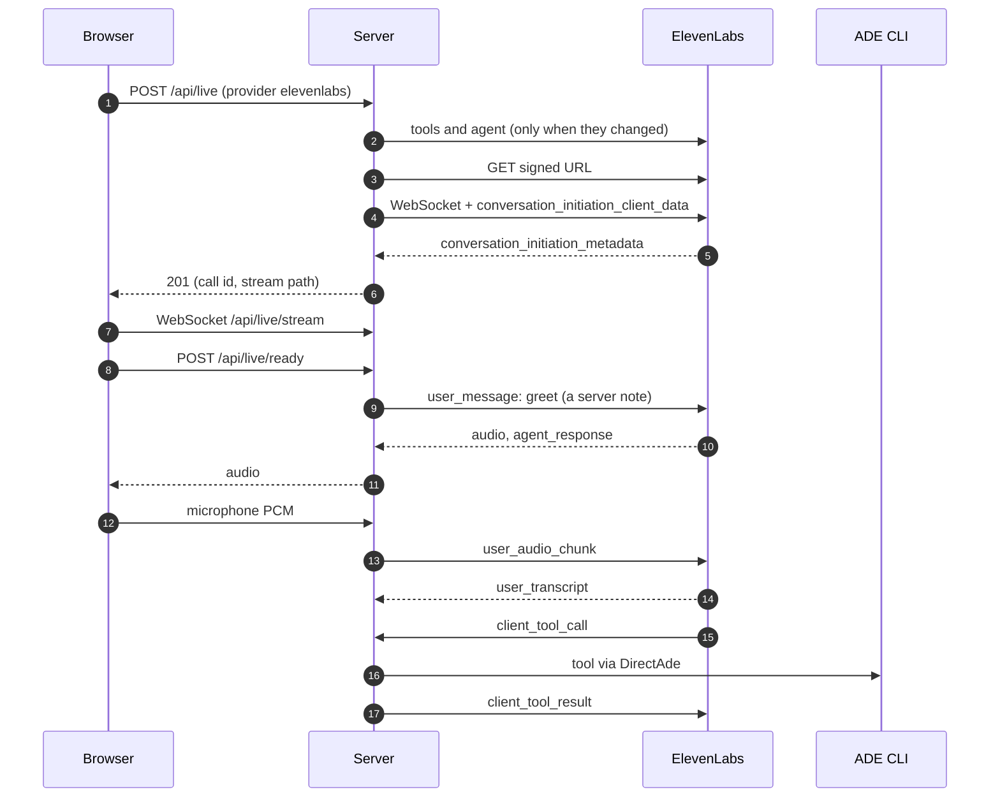

# ElevenLabs Agents

ADE Call can run a call on ElevenLabs Agents (Conversational AI) instead of
OpenAI Realtime or Gemini Live. You choose it by picking **ElevenLabs Agents** as
the model in **Settings → Voice**, then the language model (LLM) that thinks and
calls the tools, and an ElevenLabs voice. Everything above the provider stays the
same: the same instructions, the same ADE tools, the same
[send rule](delivery-safety.md#the-send-rule), the same conversation panel and
thread notices. The code is in [src/voice/elevenlabs.mts](../src/voice/elevenlabs.mts)
(server); the page uses the same audio relay as
[Gemini Live](gemini.md#how-a-call-works) ([public/relayed-call.ts](../public/relayed-call.ts)).

ElevenLabs transcribes your voice, runs the chosen LLM and speaks its answer with
its own voices. The LLM calls the ADE tools itself, as ElevenLabs "client
tools": ElevenLabs asks this server to run each one, the server runs it and
answers, and the LLM waits for the result before it speaks about it. No other
model or agent sits between the voice and the tools.

## Language models and voices

Settings offers these LLMs, all run by ElevenLabs with tool calling; a value set
by hand in `config.json` stays offered.

| `elevenlabsLlm` | Notes |
| --- | --- |
| `gemini-3.8-flash` (default) | Fast. |
| `claude-haiku-5-5` | Fast. |
| `claude-sonnet-5-5` | Stronger, slower. |
| `gpt-6.2-sol` | Stronger, slower. |
| `glm-52` | Hosted by ElevenLabs. |

The voices are ElevenLabs' multilingual default voices by name (`Sarah`,
`Jessica`, `Alice`, `Lily`, `Eric`, `Brian`, `George`, `Will`); any other value
in `elevenlabsVoice` is used as a voice ID. ElevenLabs bills the call minutes of
your plan and the LLM at cost; see its pricing page.

## The agent in your account

A conversation needs an agent in the ElevenLabs account of the key. On the first
call the server creates the ADE's tools as client tools and one agent named
**ADE Call** with them attached, and keeps their IDs in its state (the `meta`
table of `caller.sqlite`, with a fingerprint of the key's account, never the key).
Later calls reuse them. When the tools change (another ADE, a new version of
ADE Call), the changed tools are created again, the agent is updated and the
replaced tools are removed. An agent deleted in the dashboard is created again
on the next call, and so are its tools if ElevenLabs says they are gone too; a
busy or failing provider (429, 5xx, no connection) fails the call and keeps the
saved IDs, so nothing is duplicated. Do not edit the agent by hand: the next
change overwrites it.

The agent is created with:

- no first message (the server asks for the greeting, as with the other providers);
- no built-in tools (no end call, no transfer);
- turn timeout and silence hang-up off: the agent never re-engages you or hangs up for silence;
- 16 kHz PCM in and 24 kHz PCM out (the relay's formats), plain speech without
  expressive tags, a maximum of one hour per conversation;
- authentication on (a conversation opens only with a signed URL);
- overrides allowed for the prompt, the LLM, the language, the voice and the
  recognition keywords, which each call sets.

## How a call works

The server holds the provider socket and the key, and relays the audio, for the
same reason as with Gemini: whoever holds the socket receives the tool calls.
The signed URL carries a short-lived token and is never logged; errors that could
quote it, or the key, are replaced by a generic message or redacted.

Each call sends, as overrides: the instructions built by
[`directInstructions()`](../src/direct/prompt.mts) with the owner's custom
instructions, followed by the resume of the conversation and the catalog as
server notes; the LLM; the language of the call (its primary subtag); the voice;
and up to 50 of your project and thread names as recognition keywords.

The greeting request, notices to announce and the language reminder go as
`user_message`, which asks the LLM for a reply; quiet notices go as
`contextual_update`. Both are wrapped in the header that says they are server
notes and never authorize a send ([resources/voice_notes.json](../resources/voice_notes.json)).
They never enter the send rule's history: only transcripts of your voice do,
and a transcript identical to a note the server sent is ignored.

## The send rule with ElevenLabs

The rule is the one in [delivery-safety.md](delivery-safety.md); only the
events that feed it differ.

- ElevenLabs decides where your turn ends and then sends its transcript
  (`user_transcript`) once, before the LLM answers. Each transcript is a user
  turn. As with the other providers, one that only recites the recognition
  keywords is shown but is not a turn ([hint-echo.mts](../src/conversation/hint-echo.mts)).
- Each `client_tool_call` runs once per `tool_call_id` through
  `DirectSession.run()`. Because a turn's transcript always arrives before the
  LLM answers it, a sending tool with no new user words is refused at once with
  `NOT SENT (no_user_turn)`: unlike with Gemini, it does not wait for a late
  transcript, so words you say after the request never authorize it. An ID the
  provider asks for again gets the same result and never runs again.
- ElevenLabs cannot cancel a tool call. A send that ran, or may have, is not
  undone: hanging up or interrupting never cancels ADE work.

## Limits of the provider

- A conversation cannot be resumed: if ElevenLabs closes it (an error, the one
  hour limit), the call ends with a notice, and ADE work keeps running.
- Barge-in is ElevenLabs' own turn detection; **Interrupt** only empties the
  page's playback. When you speak over the agent, ElevenLabs cuts its response
  and the conversation keeps what was actually spoken.
- Reasoning, turn taking, noise reduction and the transcription model are OpenAI
  settings; Settings hides them while ElevenLabs Agents is chosen.

## What has been verified

The engine is tested offline with a simulated REST API and simulated sockets
([test/elevenlabs.test.mts](../test/elevenlabs.test.mts)): tool schemas, the agent
and tools created once and updated when they change, recovery from an agent or
tools deleted in the dashboard, the overrides of a call, a refused conversation,
the send rule with notes and keyword recitals, duplicate call IDs, the audio
relay, pings, interruptions, corrections and quiet and spoken notices. The
settings and key routes are tested in [test/settings-http.test.mts](../test/settings-http.test.mts).

The [conversation evaluations](evals.md#elevenlabs-agents) run the battery on
ElevenLabs with `--model elevenlabs-agents --llm LLM`: real conversations with the
production engine, a synthetic user and a simulated T3. They are paid. Treat
ElevenLabs Agents as experimental until it has been tried in real calls.
