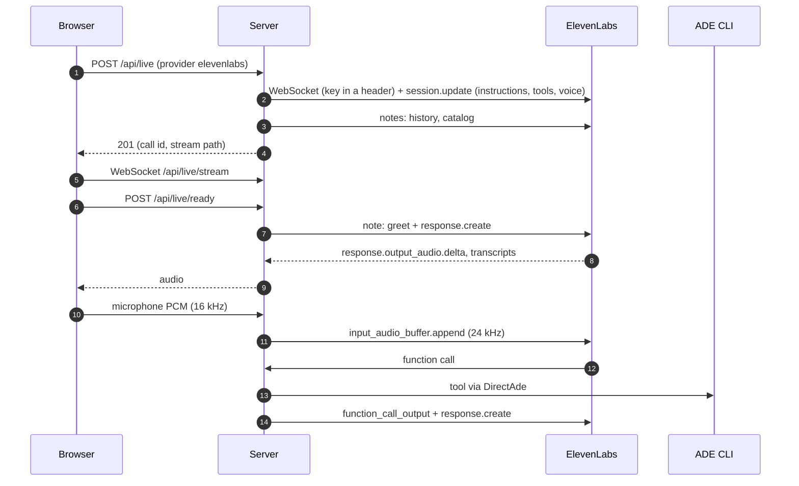

# ElevenLabs Realtime

ADE Call can run a call on ElevenLabs Realtime instead of OpenAI Realtime or
Gemini Live. You choose it by picking an ElevenLabs Realtime model in
**Settings → Voice**, then one of its voices; the model decides the provider.
Everything above the provider stays the same: the same instructions, the same ADE
tools, the same [send rule](delivery-safety.md#the-send-rule), the same
conversation panel and thread notices. The code is in
[src/voice/eleven-realtime.mts](../src/voice/eleven-realtime.mts) (server); the
page uses the same audio relay as [Gemini Live](gemini.md#how-a-call-works)
([public/relayed-call.ts](../public/relayed-call.ts)).

ElevenLabs Realtime is a speech-to-speech model that speaks OpenAI Realtime's
protocol: the same session, events, function calls and semantic turn detection.
So the engine is OpenAI's ([src/voice/realtime.mts](../src/voice/realtime.mts)),
extended only where the provider differs. The voice model calls the ADE tools
itself; nothing else sits between it and the tools.

## Models and voices

| Model | Notes |
| --- | --- |
| `eleven_realtime_v1_max` (default ElevenLabs choice) | Reasons before it answers; ElevenLabs recommends it for multi-step work with tools. |
| `eleven_realtime_v1_mini` | Cheaper and a little faster; weaker with tools. |

The voices are ElevenLabs' multilingual default voices, by the names the API
accepts (`sarah`, `jessica`, `alice`, `lily`, `eric`, `brian`, `george`, `will`). A
value set by hand in `elevenlabsVoice` stays offered. The ElevenLabs key needs
access to Agents; ElevenLabs bills the minutes of your plan.

## How a call works

There is no WebRTC leg: the Realtime API is WebSocket only. The server holds the
provider socket with the key and relays the audio, as with Gemini Live, so the
page never sees the key or a tool call. The page captures 16 kHz PCM; the server
resamples it to the 24 kHz the provider takes, and the answer comes back at
24 kHz. When the provider's voice activity detection hears you, the page drops
the audio it had queued, even if the provider had already finished the answer;
**Interrupt** also cancels the response. Muting sends half a second of silence so
that turn detection ends your turn. The interrupted answer is not truncated in the
provider's history (as with Gemini); the evaluations do truncate it.

A call starts only once ElevenLabs accepts its session (`session.updated`); a
refusal, such as an unknown voice, fails the call with the provider's reason.

## The session

The session is OpenAI's: the instructions built by
[`directInstructions()`](../src/direct/prompt.mts) with the send steps of
[resources/gemini_prompt.txt](../resources/gemini_prompt.txt) (as with Gemini: in the
evaluations the model sent without proposing the message, or on a lone
mistranscribed word) and the owner's custom instructions, the ADE's tools with the schemas from
[resources/tools.json](../resources/tools.json), semantic turn detection that
interrupts the answer, and the voice. What differs:

- Audio is `audio/pcm` at 24 kHz in both directions.
- Transcription is the provider's own, fixed to the call's language (its
  primary subtag); there is no transcription model to choose and no hint list.
- Reasoning, noise reduction and the transcription model are OpenAI settings;
  Settings hides them while an ElevenLabs model is chosen. Turn taking
  (`realtimeEagerness`) is shown and applies; `auto` means ElevenLabs' `medium`.
- ElevenLabs drops `system` messages, and asking for a response with nothing new
  in the conversation turns the microphone's silence into a user turn (it was
  transcribed as "Sí." in the evaluations). So the resume, the catalog, the
  greeting request, notices and the language reminder go as user messages
  wrapped in the header that says they are server notes and never authorize a
  send ([resources/voice_notes.json](../resources/voice_notes.json)). They never
  enter the send rule's history: only transcripts of your voice do.
- The voices add expressive tags to their transcripts ("[happy]"); the server
  removes them from what it shows and keeps.

## The send rule with ElevenLabs

It is the one in [delivery-safety.md](delivery-safety.md), applied by the same
code as with OpenAI: a user turn takes its place when the provider commits your
audio, its transcript authorizes at most one send, a sending tool waits up to
2.5 s for a transcript still pending, and each call ID runs once.

## What has been verified

The engine is tested offline with simulated sockets
([test/eleven-realtime.test.mts](../test/eleven-realtime.test.mts)): the session
and its audio format, notes as user messages that never count as turns, the send
rule, the audio relay both ways and its resampling, barge-in and interrupt,
expressive tags, closing, and a missing key. The OpenAI engine's own tests cover
the shared code.

The [conversation evaluations](evals.md#elevenlabs-realtime) run the battery on
ElevenLabs with `--model eleven_realtime_v1_max` (or `_mini`): real calls with the
production engine, a synthetic user and a simulated T3. They are paid. Treat
ElevenLabs Realtime as experimental until it has been tried in real calls.
