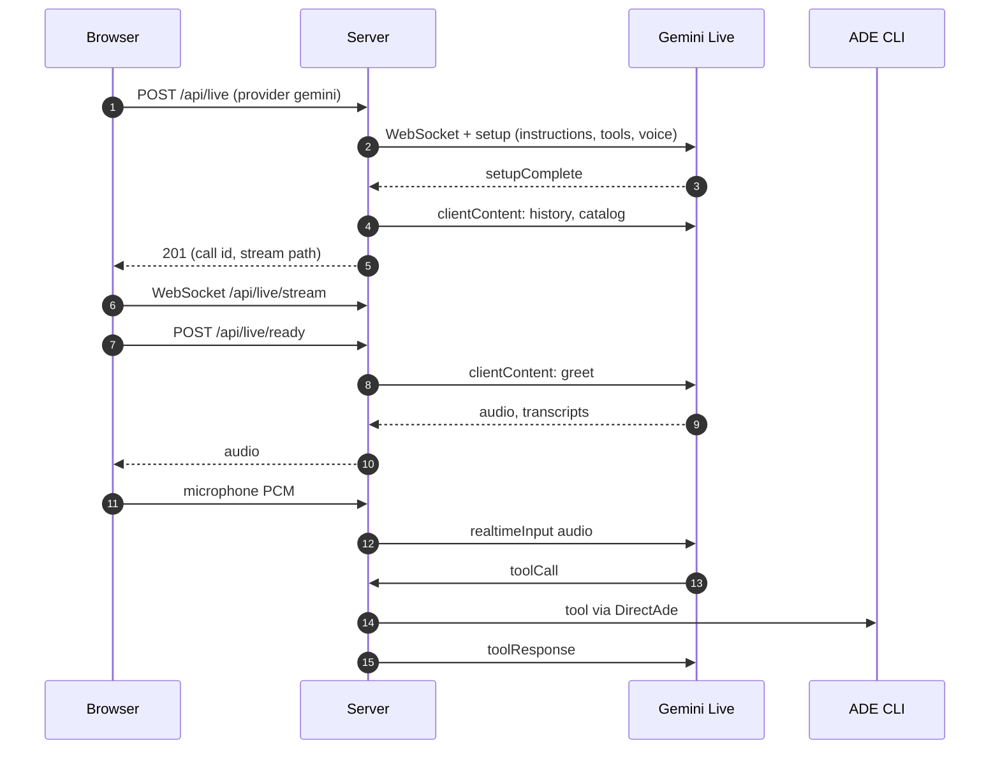

# Gemini Live

ADE Call can run a call on Google's Gemini Live API instead of OpenAI
Realtime. You choose it by picking a Gemini model in **Settings → Voice**; the
model decides the provider. Everything above the provider stays the same: the
same instructions, the same ADE tools, the same [send rule](delivery-safety.md#the-send-rule),
the same conversation panel and thread notices. The code is in
[src/voice/gemini.mts](../src/voice/gemini.mts) (server) and
[public/relayed-call.ts](../public/relayed-call.ts) with
[public/pcm-capture.ts](../public/pcm-capture.ts) (page).

The voice model calls the ADE tools itself, through Gemini Live's function
calling. No other model or agent sits between the voice and the tools.

## Models

| Model | Function calling | Notes |
| --- | --- | --- |
| `gemini-3.8-live` (default Gemini choice) | Synchronous: the tools are declared `BLOCKING`, so the model waits for each result before it speaks about it, as with Realtime. | Interleaved reasoning built in; no reasoning setting. |
| `gemini-3.1-flash-live-preview` | Always synchronous; the declarations carry no `behavior`. | Legacy preview. |

`gemini-3.8-live-extended-thinking` is not offered: it only supports
asynchronous function calling.

## How a call works

Gemini Live has no WebRTC leg and no sideband: whoever holds its socket
receives the tool calls. So the server holds it, with the key, and relays the
audio. This keeps the [architecture's](architecture.md) rule that the page
cannot run a tool or bypass the send checks, at the cost of the audio passing
through the server (about 32 KB/s up and 48 KB/s down).

- **Up:** an AudioWorklet downsamples the microphone to 16 kHz mono 16-bit PCM
  and sends 100 ms binary frames. Muting stops the frames and sends
  `audio.end`, which the server forwards as `audioStreamEnd`.
- **Down:** the model's 24 kHz PCM is played back to back through a
  `MediaStream` on the page's `<audio>` element, so the browser's echo
  cancellation, the speech indicator and diagnostic recordings treat it as
  they treat a WebRTC track. On `interrupted` (the user spoke over the model)
  the page drops the audio it has queued.
- **Control:** the browser socket only carries audio, `session.started`,
  `interrupted`, `turn.done` and `audio.end`. Transcripts, tool runs and notices
  reach the page through the usual `/api/events` stream.

The audio socket uses the API's authentication: a paired browser's cookie or
the bearer token, the configured `Origin`, and only the browser (or token) that
created the call, once. See [access.md](access.md).

## Setup

The `setup` message carries the instructions built by
[`directInstructions()`](../src/direct/prompt.mts), the ADE's tools as
`functionDeclarations` with the schemas from
[resources/tools.json](../resources/tools.json), the prebuilt voice, input and
output transcription (with your project names as `customVocabulary` on 3.8),
`historyConfig.initialHistoryInClientContent`, sliding-window context
compression and session resumption. The language is not set in the setup:
native audio models follow the instructions and the user.

Gemini Live has no system role. The resume of the conversation, the catalog,
the greeting request, notices and the language reminder enter as `user`
client content wrapped in a fixed header that says they are server notes and
never authorize a send ([resources/voice_notes.json](../resources/voice_notes.json)).
They never enter the send rule's history: only transcripts of your voice do.

## The send rule with Gemini

The rule is the one in [delivery-safety.md](delivery-safety.md); only the
events that feed it differ.

- Your words arrive as `inputTranscription` pieces, which Gemini sends
  independently of the model's output. Pieces closer than 2 s belong to one
  utterance, whatever the model says or finishes in between; only a pause
  starts a new user turn. The utterance is placed in the conversation at its
  first piece and its text grows with each one, so a "yes" counts as soon as it
  is transcribed. It is published to the conversation panel after the pause.
- The utterance a send uses is held from that moment: every piece transcribed
  while it is held joins it, however late, so the words a send already used
  never authorize another send. It is released only at a clear boundary: the
  send's result has been written to Gemini, the model has spoken after it and
  completed that turn, and the user has paused since; or the user speaks again
  and Gemini interrupts the model. Words you
  say before that boundary therefore count as part of the same turn; say them
  again after the reply if they were a new request.
- A `toolCall` may carry several `functionCalls`. Each runs once per `id`
  through `DirectSession.run()`. A sending tool with no new user words waits up
  to 2.5 s for a transcript, then is refused with `NOT SENT (no_user_turn)`.
  The results go back in one `toolResponse`. A call ID the provider asks for
  again never runs again: if it already finished it gets the same result, and
  if it is still running the result goes, when it ends, to the connection that
  asked last; if it was abandoned before it started, it gets `NOT RUN`. An ID
  repeated within one message counts once. A
  cancellation counts only for the connection that sent it: a renewed
  connection that asks for the call again still gets its result.
- If you speak over the model, Gemini may cancel calls (`toolCallCancellation`).
  A send cancelled while it still waits for its transcript is abandoned and
  sends nothing. A read that was cancelled is dropped. A send that already
  ran, or may have, is not undone: hanging up or interrupting never cancels ADE
  work. The model is told its result in a note so it can tell you, and the same
  happens for a send that finishes while the connection is being renewed: each
  function call remembers the connection it came on, and its result never goes
  as a function response to a connection that did not ask for it.

## Limits of the provider

- A connection lasts about ten minutes. The server keeps the session over a new
  connection with the latest resumption handle, up to 12 times per call, but
  only from a checkpoint Gemini marked resumable (not while it runs a function
  or generates), so the conversation is never rolled back. A renewed connection
  must report its own checkpoint before it can be renewed again. After `goAway` it
  waits for such a checkpoint until shortly before the deadline; if none comes,
  or the connection drops while the session is not resumable, the call ends
  with a notice rather than continuing without its history. Nothing is sent to
  a new connection before it confirms its setup; audio you speak during the
  switch is lost.
- There is no request to cancel a response: barge-in is Gemini's own voice
  activity detection. **Interrupt** only empties the page's playback.
- Turn taking, noise reduction, reasoning and the transcription model are
  OpenAI settings; Settings hides them while a Gemini model is chosen.

## What has been verified

The engine is tested offline with simulated sockets
([test/gemini.test.mts](../test/gemini.test.mts)): setup content, history first,
audio relay both ways, interruptions, transcripts, the send rule, duplicate
call IDs, a late yes, late pieces of an utterance that already authorized a
send (also after the pause), sends cancelled before and after dispatch, resumption only from a
resumable checkpoint, no audio before a new connection's setup, results that
finish during a reconnect, and hang-up. The
socket route is tested for authentication and origin
([test/settings-http.test.mts](../test/settings-http.test.mts)).

Not yet verified against the real service: a live call end to end, the audio
quality and echo cancellation of the relay on phones, whether silent notes sent
without `turnComplete` ever delay a reply, and the `x-goog-api-key` header on
the WebSocket handshake. Treat Gemini as experimental until a real call has
been made.
