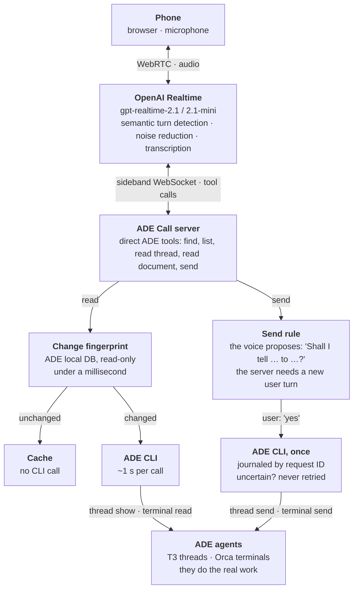

# How it works

This page follows one call from the phone to the agents in your ADE. For the
components, data stores and call lifecycle in detail, see
[Architecture](architecture.md).

## Audio

Audio goes straight from the phone to OpenAI Realtime over WebRTC; the server
never relays it. The model decides when you have finished speaking and calls
tools over a separate WebSocket that only the server holds, so the OpenAI key and
every action on your projects stay on your machine. [Voice](voice.md) covers the
session setup, turn detection and language.

## Reads

Reads first compare a fingerprint taken from the ADE's local database, read-only:
if nothing changed since the last read, the cached answer is returned without
starting the CLI; otherwise the CLI is called. This cache exists for T3. Orca has
no readable database, so its terminal reads always call the CLI and only its
listings are cached for a few seconds. See [T3](t3.md) and [Orca](orca.md).

## Sends

The voice first proposes the exact request and waits for your answer. Whether
your words accept it is the model's judgment, guided by its instructions; the
server only refuses a send unless you have spoken since the previous one. The
send then runs through the ADE's CLI once, recorded in a journal under a request
ID; if the result is uncertain it is never retried automatically. The agents in
your ADE do the actual work, and hanging up does not cancel it.
[Delivery safety](delivery-safety.md) explains each rule.
