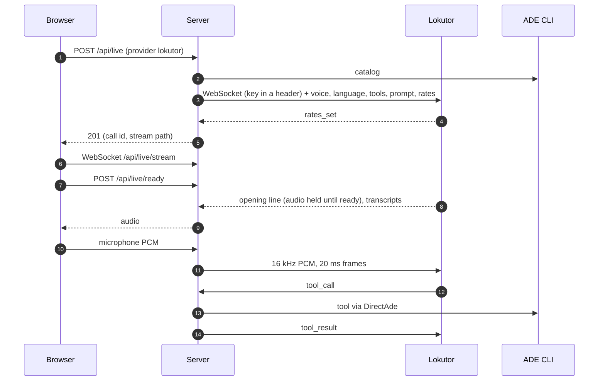

# Lokutor

ADE Call can run a call on [Lokutor](https://lokutor.com), a voice agent service,
instead of OpenAI Realtime or Gemini Live. It is a new provider here and should be
treated as experimental: it has been tested offline and with a few live calls from
a script, not yet with the [conversation evaluations](evals.md) or on phones. You
choose it by picking `lokutor` as the model in **Settings → Voice**. Everything
above the provider stays the same: the same instructions, the same ADE tools, the
same [send rule](delivery-safety.md#the-send-rule), the same conversation panel and
thread notices. The code is in [src/voice/lokutor.mts](../src/voice/lokutor.mts)
(server); the page uses the same audio relay as [Gemini Live](gemini.md#how-a-call-works)
([public/relayed-call.ts](../public/relayed-call.ts)).

Lokutor runs speech recognition, a language model and speech synthesis behind one
WebSocket (`wss://api.lokutor.com/ws/agent`, [protocol](https://docs.lokutor.com/guides/websocket-protocol)).
Its language model calls the ADE tools itself, through Lokutor's client tools: it
sends a `tool_call`, ADE Call runs it and answers with a `tool_result`. No other
model or agent sits between the voice and the tools.

## Key, voice and language

- **Key.** Create an API key in the Lokutor dashboard and save it in
  **Settings → API keys** (`lokutorKey` in `config.json`) or set `LOKUTOR_API_KEY`
  in the server's environment; the file takes priority. Lokutor bills its own
  call minutes ([pricing](https://docs.lokutor.com/pricing)).
- **Voice.** Lokutor's voices are ten slots, `F1` to `F5` and `M1` to `M5`
  (`lokutorVoice`, default `F1`; Settings shows their names, such as Claire for
  `F1`). Each slot has a native speaker in every language Lokutor speaks, so one
  voice follows the language of the call.
- **Language.** The call starts in the language chosen in Settings, else the
  browser's first preference, as with the other providers. If Lokutor's
  recognition understands it (English, Spanish, Catalan, Galician, Basque,
  Portuguese, French, Italian or German), the call is pinned to it: recognition
  listens for it, which keeps one-word answers such as "yes" reliable, and the
  voice speaks it. In any other language Lokutor follows the caller.

## How a call works

As with Gemini Live, there is no WebRTC leg: the server holds the provider socket
with the key, relays the audio and is the only one that sees the tool calls.

- **Up:** the page's 16 kHz PCM, sent on in 20 ms frames. Muting stops the page's
  frames; Lokutor measures the end of a turn on the audio it receives, so the
  server sends silence in their place until you speak again.
- **Down:** 44.1 kHz PCM (the rate Lokutor names in `server_rates`), played by the
  page as with Gemini. A confirmed interruption (`status: interrupted`) and a newer
  answer (`thinking` with a higher `generation`) drop what the page still has
  queued, and audio of an older answer is discarded. `listening` alone is a
  tentative interruption: playback goes on until Lokutor confirms it.
- **Opening:** Lokutor speaks first as soon as the session is configured (`rates`
  goes last, as its protocol asks). The server holds that audio until the page
  reports it is ready to play.

## What the model is told

Lokutor has no way for the server to add a message to the conversation: the
instructions (`prompt`) are the only channel. So they carry what other providers
get as separate messages.

- **Instructions:** [`directInstructions()`](../src/direct/prompt.mts) with the
  send steps of [resources/gemini_prompt.txt](../resources/gemini_prompt.txt) (as
  with Gemini: a voice model that has not been through the conversation
  evaluations starts with the stricter procedure), then the owner's custom
  instructions; then, from [resources/lokutor_prompt.json](../resources/lokutor_prompt.json),
  how this service delivers server notes, the greeting request, the start of the
  call (the resume of the conversation) and the ADE's catalog, each marked as data
  that never authorizes a send.
- **Tools:** the ADE's tools as OpenAI function definitions, with the schemas from
  [resources/tools.json](../resources/tools.json).
- **Recognition vocabulary:** your project and thread names (at most 100, of up to
  40 characters each) go to Lokutor's recognition as keyterms, in the connection's
  query string. The key goes in a header, never in the URL.

Lokutor adds its own speaking rules to every agent's instructions (short spoken
sentences, a natural register), and it may speak a short filler while a tool runs.
The expression tags its voices perform (`[laugh]`, `[happy]`) are removed from the
transcripts ADE Call shows and keeps.

## The send rule with Lokutor

The rule is the one in [delivery-safety.md](delivery-safety.md); only the events
that feed it differ.

- Only final user transcripts are turns; interim ones (`partial`) are ignored.
  Lokutor sends the final transcript of a turn before the function calls of its
  answer, and a sending tool still waits up to 2.5 s for one, as with the other
  providers.
- `transcript_revised` (you paused, Lokutor had barely started answering, and you
  went on) replaces the text of the same user turn. Words that a send already used
  never authorize another send, the answer Lokutor withdrew is dropped, and the
  conversation panel shows the continuation as a line of its own.
- Each call ID runs once; a repeated ID gets the same result.
- Lokutor waits 10 s for a tool's result. A tool still running after 8 s is
  answered that it is still running (nothing is cancelled or repeated); its result
  reaches the model later as a server note.
- If you speak over a running tool and Lokutor moves on to your new turn, it stops
  waiting for that result. A send that already ran, or may have, is told to the
  model in a server note; a send still waiting for its transcript is abandoned and
  sends nothing.

## Limits of the provider

- **Notices are not spoken at once.** Thread notices, late tool results and the
  result of a send Lokutor stopped waiting for are added to the instructions as
  server notes (the `prompt` message is sent again). That is silent: the voice
  tells them in its next answer, which is the answer to what you say next or
  Lokutor's own check-in after about 10 s of silence (once per silence). With
  OpenAI Realtime and Gemini Live a final notice is spoken as soon as the line is
  quiet. A note stays in the instructions until an answer after it has been
  spoken.
- **No greeting request.** The greeting is part of the instructions and Lokutor
  opens the call itself; the conversation's history and the catalog are in the
  instructions too, not in separate messages.
- **No reasoning, turn-taking, noise reduction or transcription settings.** Turn
  detection, interruptions and echo handling are Lokutor's own; Settings hides the
  OpenAI settings while `lokutor` is chosen.
- **No request to cancel an answer.** **Interrupt** only empties the page's playback.
- **Lokutor's own session rules apply.** After about 10 s of silence the voice
  checks in once ("are you still there?"); a session in which nobody speaks for
  5 minutes ends, and the call ends with a notice; long conversations are
  summarized by the service as they grow, so its model sees earlier tool outputs
  in summary.
- **A pinned language holds for the whole call.** To switch, change the language in
  Settings and call again.
- **No session resumption.** If the connection to Lokutor drops, the call ends with
  a notice; ADE work already sent keeps running.
- The [conversation evaluations](evals.md) do not run on Lokutor yet.

## Errors

| You see | Cause |
| --- | --- |
| `Lokutor refused the API key (401).` | The key is wrong or was revoked. |
| `Lokutor cannot start a call: the account has no balance left (402).` | Top up the Lokutor account. |
| `Lokutor refused the call: too many calls at once on this account (429).` | Another session of the same account is using the allowance. |
| `Lokutor refused the session: …` | Lokutor rejected a configuration value, such as a voice set by hand that it does not know. |
| `Lokutor ended the call (…)` | Lokutor closed the session; the reason it gave follows, such as five minutes with nobody speaking. |

## What has been verified

The engine is tested offline with simulated sockets
([test/lokutor.test.mts](../test/lokutor.test.mts)): the configuration and its
order, the audio relay both ways, interruptions and generations, tool calls and
results, the send rule with final, interim and revised transcripts, cut answers,
tools that outlast Lokutor's wait, sends overtaken by a new turn, notices, errors and
hang-up. The settings and key endpoints are tested in
[test/settings-http.test.mts](../test/settings-http.test.mts).

A few short live calls (November 2026, Spanish and English, with questions
synthesized beforehand) ran against the real service from a script in place of the
page: one through the server's own routes (`/api/live`, the audio socket with the
bearer token, ready, close) with no ADE installed, the others straight on this
engine with the evaluation harness's simulated T3 behind the production T3 tools.
In them the session was configured, the voice greeted in the call's language,
answered spoken questions, searched and read threads with the ADE tools, and
proposed a send that ran only after the spoken yes (the simulated T3 recorded it;
nothing was delivered). It answered "what projects do I have?" from the catalog
without reading, presenting the statuses as what the catalog shows. Not verified
yet: a call from a browser or a phone end to end, echo on phones, and the
conversation evaluations.
