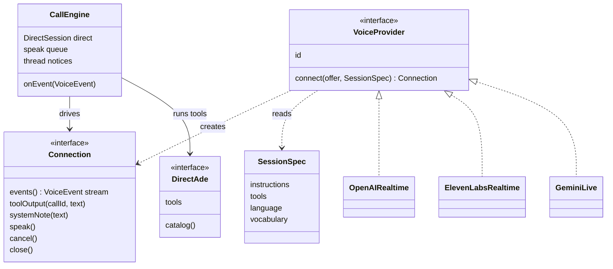

# Roadmap

Known limitations and possible improvements. Nothing here is a commitment: each
item records the current state as the code shows it, a direction that looks
feasible, a rough size (S: days, M: one or two weeks, L: larger or blocked on
upstream work) and where to start reading.

## 1. Voice providers

### Current state

The only voice engine is OpenAI Realtime, in
[src/voice/realtime.mts](../src/voice/realtime.mts). It is ADE-agnostic (it runs
whatever [`DirectAde`](../src/direct/contract.mts) it is given, and a test checks it
imports no T3 or Orca code), but it is not provider-agnostic. `RealtimeCalls`
assumes all of the following:

| Concern | What the code assumes today |
| --- | --- |
| Audio transport | The browser opens WebRTC directly to OpenAI ([public/app.ts](../public/app.ts) creates an `RTCPeerConnection` and an `oai-events` data channel); the server posts the SDP offer to `/v1/realtime/calls` and returns the answer (`LiveResponse.transport.sdp`). |
| Control channel | A server-side sideband WebSocket to `wss://api.openai.com/v1/realtime?call_id=…`, used for tools, system notes and `response.create`. |
| Session config | One OpenAI `session` object: `semantic_vad` with `eagerness`, `noise_reduction`, `gpt-4o-transcribe` with a language and a vocabulary prompt, `reasoning.effort`, `voice`. |
| Turn ordering | `input_audio_buffer.committed` and `response.output_item.added` reserve a slot per item, so a late user transcript still precedes the reply to it. The send rule ([delivery safety](delivery-safety.md)) depends on that order. |
| Transcripts | `conversation.item.input_audio_transcription.completed/failed` and `response.output_audio_transcript.done`, keyed by `item_id`. |
| Tool calls | `response.output_item.done` with `type: function_call` and a `call_id`; outputs go back as `function_call_output` items. The `call_id` becomes the dedup key via `requestIdFor`. |
| Interruption | Barge-in is the provider's VAD (`interrupt_response: true`); the explicit endpoint sends `response.cancel` and `output_audio_buffer.clear`. |
| Lifecycle | Hang-up via `/v1/realtime/calls/{id}/hangup` for `rtc_` IDs; usage summed from `response.done`. |
| Configuration | `openaiKey` and `realtime*` fields in [src/server.mts](../src/server.mts); `/api/status` reports `voiceModel` with OpenAI-specific fields. |

The parts that are already provider-neutral are worth keeping as they are:
[`DirectSession`](../src/direct/session.mts) (send rule, one run per call ID,
uncertain deliveries), the speak queue and idle logic (`flush`, `idle`, `later`),
thread notices, the catalog/prefetch on open, and the event publishing to the
conversation panel.

### Proposed direction

Split `RealtimeCalls` into a provider-neutral call engine and small provider
adapters that translate one wire protocol into a fixed set of events.

`CallEngine` is today's `RealtimeCalls` minus every OpenAI string: it builds a
`SessionSpec` from `directInstructions`, the ADE's tools, the chosen language and
the catalog vocabulary, and hands it to a `VoiceProvider`. The provider returns a
`Connection`, which is the only object that knows the wire protocol. The engine
consumes a normalized `VoiceEvent` stream and calls back through the connection to
return tool outputs, add system notes, request speech, cancel a response or hang
up. `DirectAde` stays unchanged: the engine still runs tools through
`DirectSession`, so the send rule and dedup apply identically to every provider.

What a provider must supply, as normalized events:

| Event | Required content | Why |
| --- | --- | --- |
| `userTurnStarted` / `userTurnCommitted` | a stable item ID, emitted in conversation order | The send rule places a user turn before the reply it caused, even if its text arrives late. |
| `userTranscript` / `userTranscriptFailed` | the item ID and final text | A send needs a transcribed user turn; a failed one must leave no gap. |
| `assistantItem` / `assistantTranscript` | item ID, text | Ordering and the conversation panel. |
| `toolCall` | a unique, provider-assigned call ID, name, JSON arguments | The call ID is the dedup key; without one a provider cannot send. |
| `responseStarted` / `responseDone` | optional usage | Idle detection for notices and replies. |
| `speechStarted` / `speechStopped` | — | Notices wait for the user to be quiet. |
| `closed` | reason | Lifecycle and the conversation's close marker. |

A provider must also declare its transport (browser-direct WebRTC vs.
server-proxied audio over the existing authenticated WebSocket), whether it
truncates interrupted audio itself or needs a played-duration hint, and which
settings it accepts. Configuration would move from `openaiKey`/`realtime*` to a
`voice.provider` plus a per-provider block. On the browser side, `bindLiveEvents` and `normalizeLiveEvent` in
[public/live-events.ts](../public/live-events.ts) already normalize transcript
event names; transport setup in `app.ts` would need a second path for proxied
audio.

Size: M for the refactor with OpenAI as the only provider (tests in
`test/realtime.test.mts` and `test/realtime-direct.test.mts` should pass
unchanged against the engine); M per additional provider, plus real-call
evaluation for each. A provider whose protocol cannot guarantee per-item ordering
or unique call IDs should not be allowed to expose sending tools.

### ElevenLabs and Gemini

Both now exist as engines of their own, without this refactor:
[Gemini Live](gemini.md) and [ElevenLabs Agents](elevenlabs.md) hold the provider
socket on the server and relay the audio through the same authenticated
WebSocket. ElevenLabs answers the open questions this section used to list: each
tool call has a provider-assigned `tool_call_id`, and a user turn's transcript
arrives once, before the LLM answers it. The `VoiceProvider` split above would
remove the code the three engines repeat (notes, notices, tool dispatch).

## 2. Orca integration

The Orca adapter ([src/direct/orca.mts](../src/direct/orca.mts),
[src/adapters/orca/](../src/adapters/orca/)) uses `repo list`, `worktree ps`,
`terminal list`, `terminal read`, `terminal send` and `agent launch`. Its stated
limits live in its `DirectPrompt` and in [orca.md](orca.md).

| Gap | Current state | Possible direction | Size |
| --- | --- | --- | --- |
| Structured chats | Not read or continued; the voice reads terminal output, which can be fragmented and include unsent drafts. | Add read/continue tools once the Orca CLI exposes chats with stable IDs, and set `listThreads`/`readThreadMessages` in the [registry](../src/adapters/registry.mts). | M, blocked upstream |
| Finish notices | The thread watch follows only T3 deliveries; Orca sends start no watch. | A terminal-based watcher could detect an agent returning to its prompt, but that is a heuristic; a CLI status or event stream would be needed to make it honest. | M |
| Stop or interrupt | Not offered; the prompt tells the model to say so. | A tool only when the CLI has an explicit stop for an agent. Sending control keys to a terminal is not a substitute. | S once exposed |
| Workspace creation | `agent launch` requires an existing worktree. | A gated `orca_create_workspace` tool if the CLI supports it, with the same journal as other sends. | S–M |
| Verified delivery | Sends carry no reference, so an uncertain send can only be released by the user after reading the terminal. | If Orca returned a submission ID or message history, an uncertain send could be confirmed the way T3's are. | M, blocked upstream |
| CLI drift | Arguments are hard-coded. | Check `orca --version` or `--help` at startup and report unsupported versions in `/api/status`, as T3 does for its database format. | S |

## 3. T3 integration

| Gap | Current state | Possible direction | Size |
| --- | --- | --- | --- |
| Stop a thread | The CLI used (`thread list/show/start/send`) has no interrupt; the prompt explains the limit. | Add a sending-class tool behind the send rule when the CLI exposes one. No internal API or database write. | S once exposed |
| Project listing | `projection_projects` and the thread index are read from `userdata/statev2.sqlite` in read-only mode ([src/adapters/t3/client.mts](../src/adapters/t3/client.mts)); a schema change fails explicitly. | Prefer a CLI project listing when available and keep SQLite only for the read-cache fingerprint, or drop it if the CLI offers a cheap change marker. | S–M |
| Delivery mode | `thread send` queues behind a busy turn; the receipt reports the mode T3 returns but cannot choose it. | Expose steer/queue as a parameter if the CLI adds a flag, with the model required to say which one it used. | S once exposed |
| Discovery latency | Subagent discovery runs up to four CLIs in parallel; the catalog arrives after the call connects. | Measure with `scripts/measure-projects.mts` and `scripts/measure-startup.mts` on large installations; a persisted catalog snapshot could make the first turn faster. | S–M |

## 4. Platform and operations

- **macOS and Windows.** Not validated. The server is plain Node 24 and should
  start, but paths (`~/.config`, `~/.local/share`), the T3 binary lookup
  (`~/.local/bin/t3`), file modes (`0600`) and the installer are Linux-oriented.
  A first step is a CI job that runs `npm test` on macOS and Windows. Size: S for
  CI, M to fix what it finds.
- **Service managers.** [scripts/install-user.sh](../scripts/install-user.sh) and
  [scripts/write-service.mts](../scripts/write-service.mts) produce only a systemd
  user unit. A launchd plist for macOS, and documented examples for other
  supervisors, would cover most other setups. Size: S each.
- **Packaging.** Installation is a git checkout plus `npm ci`. An `npx`-runnable
  package is plausible since state and config live outside the checkout. A
  container is less natural: the server needs the host's T3/Orca CLIs and their
  data directories. Size: S–M for npm; container only if a clear use case appears.
- **Single active call.** The server allows one call at a time across all ADEs
  (`voiceBusy` in [src/server.mts](../src/server.mts)). That is deliberate for one
  owner; it would have to change for multi-user use.

## 5. Multi-user and security

All paired browsers control the same installation; there are no accounts or
roles ([access.md](access.md)). A session identifies a browser profile, not a
device. Options that could be considered, not planned:

- **Passkeys (WebAuthn)** as an alternative to one-time pairing codes, binding a
  session to an authenticator. Adds no dependency if done with the browser API and
  a small verifier, but the verifier is security-sensitive code. Size: M.
- **Per-user state.** Separate conversations, journals and pairings per account.
  This touches the store, the runtime map and every event's scope. Size: L, and it
  only makes sense if several people share one T3 installation.
- **Read-only pairings.** A browser that can call and read but never send. Small
  to implement at the tool layer (filter `sends` tools). Size: S.

## 6. Quality

- **Real-call evaluation.**
  [scripts/replay-realtime.mts](../scripts/replay-realtime.mts) replays a recorded
  microphone channel against the real provider with real reads and simulated
  sends. It is open-loop and manual. A small corpus of consented, anonymized
  recordings with expected tool sequences (and no expected sends without a "yes")
  would turn it into a regression check for prompt and model changes. Size: M.
  Paid; never part of `npm run check`.
- **Browser end-to-end.**
  [scripts/smoke-browser.mts](../scripts/smoke-browser.mts) is explicit and uses
  the paid API with `TEST_VOICE=1`. A fake WebRTC peer on the server side would
  let it run in CI without a provider. Size: M.
- **Structural send check.** The server enforces that a send follows a new
  transcribed user turn; whether that turn answered a proposal is judged by the
  model ([src/direct/session.mts](../src/direct/session.mts)). If unwanted sends
  appear in evaluations, a server-side check that the previous assistant turn
  proposed this destination is the next step. Size: S–M.

## 7. Other

- **Provider error codes.** The `error` handler in `realtime.mts` reports unknown
  codes as "Voice error: CODE". Mapping the common ones (quota, model access,
  session expiry) to actionable messages would help first installs. Size: S.
- **Usage reporting.** Token usage per call is stored in metadata
  (`usage:CALL_ID`) but not shown. A per-conversation total in the UI is cheap.
  Size: S.
- **Recording retention.** Diagnostic recordings are never deleted automatically.
  An optional age or size limit would avoid manual cleanup. Size: S.

The source tree has no `TODO` or `FIXME` markers; the items above come from
stated limits in the code and docs rather than from inline notes.
