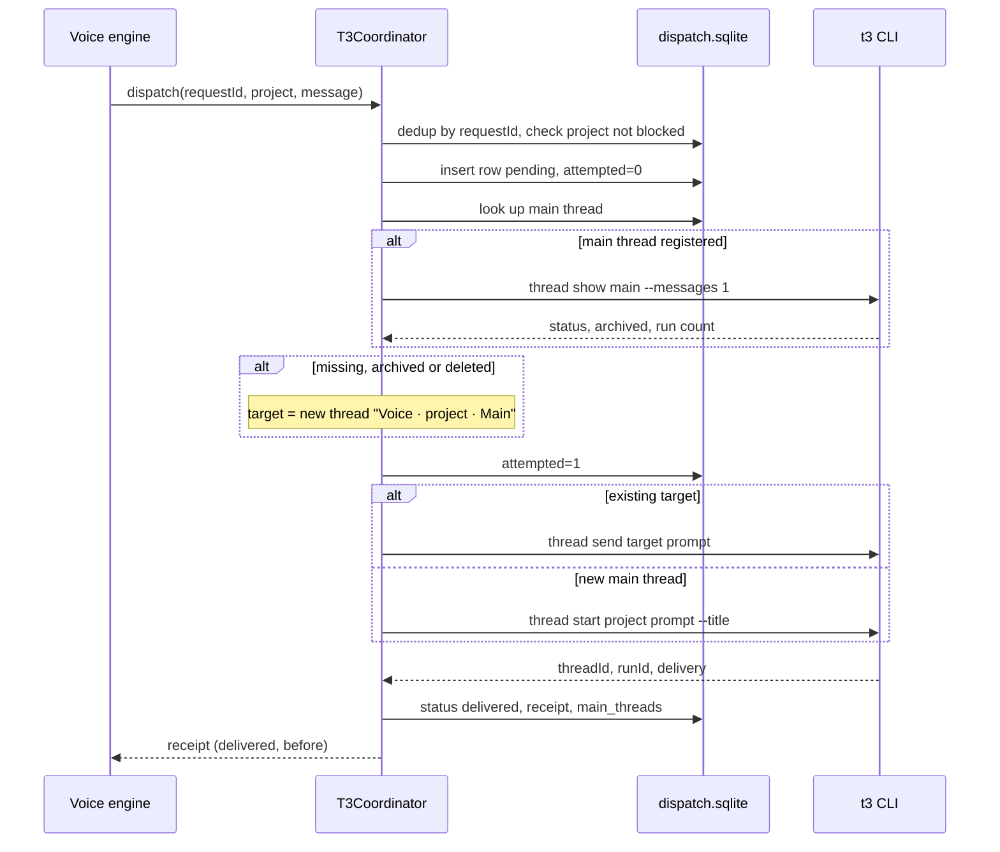

# T3 adapter

The T3 adapter connects ADE Call to the [T3 Code](https://github.com/pingdotgg/t3code)
installation on the same machine. It reads projects and threads, lets the voice read
thread messages, and carries requests the user has approved to T3 agents. The agent
does the work; ADE Call keeps a receipt and a link.

Code: [`src/direct/t3.mts`](../src/direct/t3.mts) (voice layer) on top of
[`src/adapters/t3/`](../src/adapters/t3) (CLI, local reads, journal, cache, formats).
For the shared model see [adapters](adapters.md).

## How ADE Call talks to T3

Two channels, both local:

- **The `t3` CLI** for everything that reads live state or changes something. Every
  call adds `--base-dir $T3CODE_HOME --json`, has a 20 s timeout and a 4 MB output
  limit. Stderr is never shown to the model. An ID argument (the thread or project
  of `show`, `send` and `start`, the value of `--project`) that starts with `-` or
  contains spaces or control characters is refused before the CLI runs, so it can
  never be parsed as an option. `thread show` also passes its thread ID after `--`,
  behind every flag; `send` and `start` keep the plain form, since `--` was only
  checked with a read.
- **Read-only SQLite** on `$T3CODE_HOME/userdata/statev2.sqlite`, opened with
  `readOnly: true`, for metadata the CLI does not expose and for cheap change
  detection. ADE Call never writes to T3's database; every mutation goes through
  the CLI.

| CLI command | Used for |
| --- | --- |
| `thread list --project <id>` | Threads of a project, for the web overview and `t3_list_threads`. |
| `thread show <id> --messages <n>` | Thread status and its latest messages: reads, subagent status, the pre-send check, the thread watch. |
| `thread send <thread> <prompt>` | Deliver a request to an existing thread. |
| `thread start <project> <prompt> --title <title>` | Create the project's main voice thread with the first request. |

| SQLite table | Columns read | Used for |
| --- | --- | --- |
| `projection_projects` | `project_id`, `title`, `workspace_root`, `archived_at`, `deleted_at` | The project list. T3's CLI has no project listing command. |
| `orchestration_v2_projection_threads` | `thread_id`, `project_id`, `title`, `payload_json`, `archived_at`, `deleted_at`, `updated_at` | Open-thread index for the catalog and search, subagent lineage, detecting a deleted main thread, cache fingerprint. |
| `orchestration_v2_projection_runs` | `ordinal`, `status`, `completed_at` | Cache fingerprint. |
| `orchestration_v2_projection_messages` | `updated_at`, `streaming` | Cache fingerprint. |
| `orchestration_v2_projection_runtime_requests` | `status` | Cache fingerprint. |

A thread is open when it is not archived, not deleted and not settled
(`payload_json` must carry `settledAt` and `settledOverride`, matching T3's own
predicate). If the payload does not have the expected shape, the read fails with a
"format this version of ADE Call does not recognize" error instead of guessing.
An unreadable database gives a separate error. Neither includes SQLite messages or
paths.

`T3_BIN` selects the CLI (default: `~/.local/bin/t3` if present, else `t3` on
`PATH`) and `T3CODE_HOME` selects T3's data (default `~/.t3`). See
[configuration](configuration.md).

## Tools

The voice gets six tools and nothing else: no Bash, no project editing, no tools of
another ADE. Their descriptions and schemas are in
[`resources/tools.json`](../resources/tools.json).

| Tool | Sends | What it does |
| --- | --- | --- |
| `t3_find_threads` | No | Matches open top-level thread titles (subagents on request) and project names against what the user said. Local metadata only. |
| `t3_list_threads` | No | Lists top-level threads of one or all projects, or the subagents under a thread. |
| `t3_read_thread` | No | Reads a thread's status and latest messages, with per-call memory. Also confirms uncertain sends by reference. |
| `t3_read_document` | No | Reads a page of a `.md` or `.txt` file inside a listed project ([rules](adapters.md#capabilities-t3-and-orca)). |
| `t3_send_message` | Yes | Sends an approved request to a named thread or to the project's main thread. |
| `t3_release_uncertain` | Yes, keeps authorisation | Unblocks a project after an uncertain send, by the user's decision. Sends nothing. |

### Catalog and short IDs

When a session opens, the voice receives a compact catalog: one line per project
(with its documents) and, under it, its open threads with the last observed status,
the update date and a short ID. Subagents hang under their parent with `↳`.
Projects and threads are sorted by recent activity. The catalog lists at most 150
threads; beyond that it says it was trimmed and points to `t3_find_threads`. It is
built from the local projection plus the server's last observation, so it is a
starting point, not proof of status.

Short IDs are the first 8 characters of a UUID, longer if two known IDs share that
prefix. Non-UUID IDs (some subagents are named after their provider thread) get an
`s…` alias. Before any tool runs, `projectId`, `threadId`, `parentThreadId` and
`rootThreadId` are resolved against the IDs shown in this call; an unknown,
ambiguous or too short value fails with "nothing was executed". Full IDs always
work; a long non-UUID ID is accepted unseen only if it has no spaces and does not
start with `-`.

### Reading a thread

`t3_read_thread` returns a header (title, short ID, project, status, archived or
settled, parent, pending requests in T3, update time) and the 6 most recent
messages by default, up to 50 with `messages`. `offset` skips the N most recent to
go back in history. The text stays within about 10 000 characters: the newest
message gets up to 6000, older ones 2500, and a long message is clipped in the
middle with a hint (`messages=1, offset=N`) to read it whole. `completed` is
annotated as "end of turn, not finished work".

Within a call the read has memory. A plain re-read answers `NO CHANGES` when
nothing moved, or only the messages after the last one delivered (noting a status
change, or that the last message grew). Asking for more messages than already
received returns only the missing older ones. Reads with `offset` or `messages=1`
bypass the memory. The memory is discarded when the call ends.

### Search by name

`t3_find_threads` uses the shared matcher in
[`src/shared/spoken-match.mts`](../src/shared/spoken-match.mts). Comparison ignores
case, accents, punctuation, spacing and filler words; spoken numerals and letter
names become digits ("te tres" matches "T3"); each word is weighted by how rare it
is across all titles and project names. A project name can complete a title but
cannot match a thread on its own.

The model passes what it heard in `query` and up to five written forms in
`variants` ("Whisper" for "guisper"). When the user describes a topic instead of
naming a thread, the instructions ask for several of its meaningful words rather
than one ("revisión" and "Pi" for "the reviews of the Pi thing"). Results that match
as written come first. Only when nothing does, it returns up to ten approximate
candidates with a similarity score, labelled as hypotheses to confirm, never send
targets. Settled and archived threads are excluded unless `includeClosed=true`, but
their count is reported, counted like the visible results: those that match as
written apart from those that only resemble what was said, which are reported as
possible approximate matches to confirm, and only when nothing matches as written.
Messages and documents are not searched, so zero results do not prove absence.

Like `t3_list_threads`, the search compares top-level threads only by default: old
subagent titles often share the words of a topic and would otherwise bury the
recent top-level thread the user means. Subagents that match are counted and their
parents named, one per line (up to five, by title and short ID), with a hint to
repeat the search with `includeSubagents=true` if the user is looking for a subagent
or nothing else fits. As in the visible results, subagents that only resemble what
was said are reported as possible approximate matches, not as matches, and only
when nothing matches as written. With `includeSubagents=true`, top-level threads still
come before subagents. Within each group, a better match comes first and, among
equal matches, the most recently updated thread. The voice instructions also ask to
prefer a recent top-level thread from the catalog or a listing that fits what the user
described over old subagents. `includeClosed` and `includeSubagents` accept only
`true` or `false`: any other value, such as the text `"false"`, is rejected and
nothing is searched. `null` is the same as omitting the flag, stated scope
included.

### Subagents

`thread list --project` may return only top-level threads. ADE Call adds the
children it finds in `orchestration_v2_projection_threads`: rows whose
`payload_json` has `lineage.relationshipToParent: "subagent"` with string
`parentThreadId` and `rootThreadId`. Archived and deleted rows are excluded and IDs
are deduplicated. Each child's status is then read with
`thread show <id> --messages 1`, at most four CLI calls at a time.

`t3_list_threads` returns top-level threads (not subagents) by default. `parentThreadId` lists direct
children, `rootThreadId` all descendants, and `includeSubagents` a full listing.
As in the search, `includeSubagents` accepts only `true` or `false` (`null` is the
same as omitting it); any other value is rejected and nothing is listed. A
`parentThreadId` or `rootThreadId` includes subagents even with
`includeSubagents=false`.
A child whose status could not be read is shown as `unknown, unverified`; any
failure sets `discovery.complete=false` with a warning, and the output says that the
absence of a subagent is not proven. A `completed` parent may still have running
children.

### Read cache

Starting a `t3` process costs about a second on a small host, so
[`src/adapters/t3/read-cache.mts`](../src/adapters/t3/read-cache.mts) keeps the
CLI's own answers for `thread show` and `thread list --project` in server memory.
An entry is reused only while a fingerprint of the thread (or project) is
unchanged: count and latest update of the thread rows, the runs' ordinals, statuses
and completion times, the messages' count and latest update, and the pending
runtime requests. The fingerprint is a sub-millisecond read-only query, taken
before the CLI call so a change during the call invalidates the result.

The cache never reuses a thread with a message still streaming, and treats any
fingerprint error as a miss. Entries expire after 10 minutes, with at most 120 kept.
A miss fetches at least 60 messages so later reads of that thread are served from
memory; a concurrent read of the same key waits for the one in flight. When a
session opens, the four most recently updated threads and their projects are
prefetched, one CLI process at a time. The model receives exactly the text the CLI
would have given.

Sends never go through the cache.

## Sending

Whether a send may run at all is decided by the engine's
[send rule](delivery-safety.md). This section covers what the T3 adapter does once
it runs: [`T3Coordinator`](../src/adapters/t3/coordinator.mts) and its journal,
`ades/t3/dispatch.sqlite` in ADE Call's state directory.

### Main thread

"Main thread" means only this thread; threads that are not subagents are
called top-level threads in the tools and their results, so the model does not take a
listed thread for the main one.

A send without `threadId` goes to the project's main voice thread, recorded in the
journal's `main_threads` table. If there is none, the send creates it with
`thread start` and the title `Voice · <project> · Main`. If the registered main
thread is archived, or deleted in T3's projection, the send creates a new one, and
the receipt says so: the user approved a send to the project's main thread, not to
that specific thread. An explicitly named `threadId` takes priority; if it is
archived the send is rejected with "Nothing was sent". A thread the user named
never becomes, replaces or rewrites the project's main thread, even when the
project has none yet or the named thread is the registered main itself: only a
send without `threadId` uses or creates the main thread. The new
thread uses the T3 project's default model.



The coordinator first checks the journal inside one transaction: a repeated
`requestId` with the same content returns its stored receipt instead of sending
again, and an uncertain earlier send to the same project blocks this one. It then
records the new row as `pending` with `attempted=0`, so a crash at this point is
provably harmless.

With a registered main thread, a `thread show` checks that it still exists, belongs
to this project and is not archived, and captures the run count and latest run ID
as the baseline (`before`) for the thread watch. If the thread is gone, the target
falls back to a new main thread. Any error up to here is `NotDispatchedError`: the
voice hears "Nothing was sent" and the user's approval is not used up.

Just before invoking the CLI the row is marked `attempted=1`, conditionally on
still being `pending`. From that moment any failure, including a response without
the expected `threadId`, leaves the row `unknown` and the project blocked. On
success the receipt is stored, for a send without `threadId` the main thread is
registered (or replaced), and the receipt goes back to the engine, which starts
the thread watch. What happens with an `unknown` row is described in
[delivery safety](delivery-safety.md).

### The prompt T3 receives

Every send wraps the user's request in one of two templates,
[`t3_delivery_prompt_main.txt`](../resources/t3_delivery_prompt_main.txt) for the
main thread and [`t3_delivery_prompt_existing.txt`](../resources/t3_delivery_prompt_existing.txt)
when continuing a thread the user chose (any explicit `threadId`, even the
registered main thread). Both ask the agent to keep an index of
decisions and conversations, reuse suitable threads, use T3's native tools to split
work, and write in the language of the request or the thread.

The first line is always the reference line:

```text
Request received by ADE Call. Reference: voice:CALL:CALL_ID.
```

It is fixed English text because reads parse it back. When `t3_read_thread` finds
this line at the start of a line in a **user** message of the thread an uncertain
send targeted (or any thread of the project, if that send was creating the main
thread), the journal row becomes `delivered` and the read begins with a
`[CHECKED: …]` note. A reference quoted by the agent does not count: an agent can
repeat it without the send having arrived there. Only the messages that read
brought are checked, so an older send needs a larger `messages`.

### Receipts and delivery modes

T3 accepting a message is a durable delivery. It does not mean the agent ran or
finished. The receipt the voice reads looks like this:

```text
SEND ACCEPTED by T3 · queued: queued for the next turn; not running yet
Thread: 7b2d40e9 · project Garden (3f9a1c2e)
Link: …
Request: voice:CALL:CALL_ID
Accepted does not mean run or finished.
```

| `delivery` | Meaning |
| --- | --- |
| `started` | T3 started a turn with the message. |
| `queued` | The thread was busy; the message is its next turn. |
| `steered` | T3 added it to the turn in progress. |
| `restarted` | T3 restarted the turn with the message. |
| `unverified` | The CLI returned no recognised mode, or the delivery was confirmed by a read. |

`t3 thread send` never interrupts: a busy thread, including a main thread waiting
on its subagents, receives the message as its next turn. A queued delivery is still
confirmed and deduplicated; it is not resent to move it forward, and ADE Call
does not cancel children to empty the queue.

A queued delivery has no `runId` yet. The `before` baseline lets the thread watch
follow the first run that starts after the send instead of adopting the turn that
was already running. How the watch turns runs into spoken notices is described in
[voice](voice.md).

## Stopping and interrupting

The voice cannot stop or interrupt a T3 thread. T3's CLI offers `thread list`,
`start`, `send` and `show`, and `thread send` explicitly does not interrupt. Call
Center does not work around this with a message posing as a stop, internal APIs,
control keys or Bash. The prompt tells the model to say this immediately when
asked and that stopping is done in T3. Hanging up or closing the page does not
cancel T3 work either.

## Compatibility

The adapter is developed against T3 CLI v0.1.9 (`t3 --version`). It relies on:

- the four `thread` subcommands above with `--base-dir` and `--json`, and `--`
  before the positional ID of `thread show`;
- `thread send` and `thread start` returning `threadId` and optionally `runId`,
  `link` and `delivery`;
- the SQLite tables and columns listed above, and the `lineage`, `settledAt` and
  `settledOverride` fields of `payload_json`.

A change in any of these must fail with an explicit error, never be read as "no
projects" or "no threads". ADE Call's state (journal, main threads, IDs in
receipts) belongs to one T3 installation: do not point a state directory at a
different `T3CODE_HOME`.
