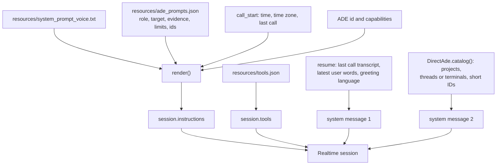
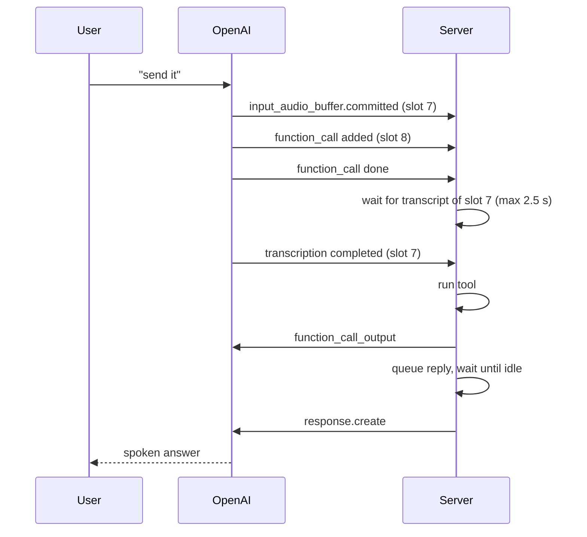
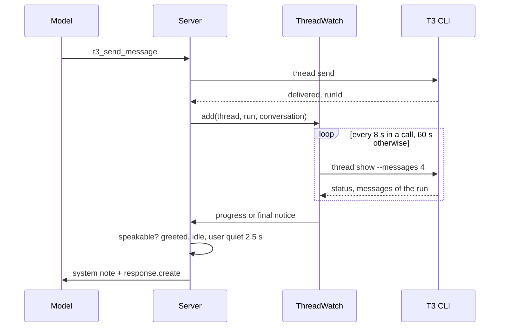

# Voice

The voice is OpenAI Realtime (`gpt-realtime` family) over WebRTC, driven by
[src/voice/realtime.mts](../src/voice/realtime.mts). The engine knows no ADE:
it runs whatever [`DirectAde`](adapters.md) the active runtime gives it. This
page covers what the model is told, how turns and interruptions work, and how
notices reach a call in progress. The transport and the overall call sequence
are in [architecture.md](architecture.md#a-call-end-to-end); what makes sends
safe is in [delivery-safety.md](delivery-safety.md).

## Session setup

The server creates each call with `POST /v1/realtime/calls`, sending the
browser's SDP offer and a session object. The fields that matter:

| Field | Value | Config key (`config.json`) |
| --- | --- | --- |
| `model` | `gpt-realtime-2.1` (or `gpt-realtime-2.1-mini`) | `realtimeModel`, or **Settings → Voice** |
| `audio.output.voice` | `marin` | `realtimeVoice` |
| `reasoning.effort` | `low` (`minimal`, `low`, `medium`, `high`, `xhigh`) | `realtimeReasoning` |
| `turn_detection` | `semantic_vad`, eagerness `low` (`low`, `medium`, `high`, `auto`) | `realtimeEagerness` |
| `noise_reduction` | `near_field` (`far_field`, `off`) | `realtimeNoiseReduction` |
| `transcription.model` | `gpt-4o-transcribe` | `realtimeTranscriptionModel` |
| `tools` | the ADE's tools, schemas from [resources/tools.json](../resources/tools.json) | – |

An invalid enum value stops the server at startup with a clear error rather
than silently falling back. See [configuration.md](configuration.md) for the
file itself.

## What the model is told

The model receives four things, in this order.

**Instructions.** [src/direct/prompt.mts](../src/direct/prompt.mts) fills
[system_prompt_voice.txt](../resources/system_prompt_voice.txt) with the ADE's
own parts from [ade_prompts.json](../resources/ade_prompts.json): who it talks
to (`role`), what a destination is called (`target`: "thread" or "agent"),
what to read to check one (`source`), where a send goes when the user names
none, how to read statuses (`evidence`), what cannot be done from here
(`limits`) and how IDs look. `{{sending}}` lists the ADE's sending tools. Two
JSON values computed at call time close the prompt: the time context (current
local time, time zone from `ADE_CALL_TIME_ZONE` or the system, and when
the previous call of this conversation ended) and the ADE's capabilities.
Rendering fails if a placeholder is left unfilled; `npm test` checks every
template renders. The rules cover language, speech style, turns, name
recognition, matching a request to one, several or no projects, evidence, the
send proposal and what accepts it, limits and notices. They guide the
model; the enforcement is on the server ([delivery-safety.md](delivery-safety.md)).

**Tools.** Each tool's description and parameter schema come from
[tools.json](../resources/tools.json) via `toolSchema()` in
[src/resources.mts](../src/resources.mts). Errors the model can receive are in
[error_messages.json](../resources/error_messages.json). See
[resources/README.md](../resources/README.md) for the file formats.

**Resume.** The first system message, built by `ProjectContext.resume()` in
[src/conversation/context.mts](../src/conversation/context.mts), says this is a
new connection and carries, as data: the tail (2.5 KB) of the last call in this
conversation that heard the user, the user's latest words, the context stored
when that call closed, and an instruction about the greeting language. It
tells the model never to execute historical requests. A new conversation
starts with no history at all.

**Catalog.** The second system message is the ADE's compact catalog: one line
per project and per open thread (T3) or workspace and terminal (Orca), most
recent activity first, with short IDs. T3 builds it from its local projection
synchronously. Orca asks its CLI; the call connects without waiting, and the
catalog is added when it arrives (within 5 s, or a fallback built from the last
observation). At the same time the engine calls `prefetch()` so that the first
reads hit a warm cache. The catalog is metadata, not evidence: the prompt
requires reading a thread or terminal before talking about its status.

### Short IDs

Speaking a UUID is impossible, and copying one costs tokens. The catalog and
every tool output pass through `DirectCallState.shorten()`
([src/direct/state.mts](../src/direct/state.mts)), which replaces UUIDs with the
shortest prefix of at least 8 characters that no other shown ID shares, and
other long IDs (Orca workspaces and terminal handles) with an `s` + 7 hex
alias. When the model passes an ID back, `resolve()` accepts only an ID shown
in this call, an unambiguous prefix of at least 6 characters, or a full ID. An
unknown, ambiguous or too short value fails before the tool runs, so a prefix
can never reach the wrong thread. The state, with its reads memory, is
discarded when the call ends.

## Language

The prompt text is English, but it never sets the language of the call. The
voice speaks the language the user speaks and follows a switch mid-call.

Before the user speaks, the greeting language is, in order: the language chosen
in the page's Settings; the language of the user's latest words in this
conversation (even from an earlier call); the browser's preferred languages
(`navigator.languages`, at most five well-formed tags); English.

Language and accent are controlled separately, as OpenAI recommends for
`gpt-realtime-2`. The session instructions open with the language the call
starts in (the Settings choice, else the browser's first preference) and its
native accent, named with its region when one is known: a bare `es` chosen in
Settings takes the region of the browser's matching `es-ES` or `es-MX`. Without
either, no language is named. The rule also keeps the accent stable for the
whole call, says that the English of instructions, tool results, notices and
names never changes language or accent, and switches language only on an
explicit request or a complete utterance in another language, not on a name,
greeting or borrowed term. Before every response the server requests (tool
results, notices, the greeting) it adds a one-line system reminder from
[voice_language.json](../resources/voice_language.json): long English data
right before a reply otherwise pulls the voice toward an English accent. The
stored `voice` event of a connected call records `language` and
`languageSource` (`settings` or `browser`).

Transcription is pinned to one two-letter language: the one chosen in
Settings, otherwise the browser's first preference; without a usable code the
provider detects it. Pinning improves accuracy in that language; speech in
another language is still understood by the voice, but its transcript, which
the send rule depends on, is less accurate. For `gpt-4o*` transcription models
the server also passes a hint prompt made only of names: up to 80 project
names, distinctive words from thread titles, workspace names and a few fixed
terms. Whole titles are not passed, because the transcriber may emit a
sentence from the hint on noise.

Messages sent to an agent are written in the user's language, or in the
thread's language when continuing one in another language. The T3 delivery
wrapper ([t3_delivery_prompt_main.txt](../resources/t3_delivery_prompt_main.txt))
tells the agent to answer in the language of the request.

## Turns and speaking

OpenAI's `semantic_vad` decides when the user has finished (low eagerness
waits longer on an open phrase), creates the response and cuts the model off
when the user speaks over it. The server does not second-guess turn detection.
What it controls is the order of items and when it asks the model to speak.

**Conversation order.** Each item gets a slot when the provider creates it: a
user turn when its audio is committed, an answer or function call when it is
added. Transcripts arrive later, often after the answer they prompted has
started. Ordering by slot, not arrival, lets the send rule see a late "yes"
before the reply to it, and lets the page show turns in the right order.

**One answer per response.** When the model calls several tools in parallel,
each output is added as soon as it is ready, but `response.create` is sent only
once every function call of that response has an output.

**Waiting to speak.** Requests to speak are queued and flushed only when no
tool output is pending, no response is active and the user is not speaking.
Replies to the user's question go out as soon as those hold. Spontaneous
notices also wait until the user has been quiet for 2.5 s. If the provider
reports that a response is already active, the request is queued again.

## Interruptions

Barge-in is the provider's: `interrupt_response: true` makes semantic VAD cut
the voice when the user speaks, and the provider truncates the unheard part of
the answer from the conversation. The prompt's interruption policy tells the
model to stop at once, not to apologize, and to answer the latest request
rather than resume. Interrupting stops speech only, never a tool call or ADE
work.

On the page, [speech-gate.ts](../public/speech-gate.ts) measures microphone
energy against the received audio to light a "you are speaking" indicator.
It never mutes playback ([playback-control.ts](../public/playback-control.ts)
records `playbackPolicy: provider`). Mute disables the microphone track
locally. `POST /api/live/interrupt` sends `response.cancel` and
`output_audio_buffer.clear` for clients that want an explicit stop; the page
does not call it.

## Notices during a call

After a send the ADE accepted, [ThreadWatch](../src/conversation/thread-watch.mts)
follows that thread's run by reading it through the CLI. It only reads: it never
sends, retries or cancels anything. Today only T3 has it, because it requires
the `readThreadMessages` capability; Orca terminals are not followed, and the
Orca prompt says so.

The watch reports three kinds of notice. **Progress**: the agent's newest
message in that run, the first after 15 s and then at most every 40 s.
**Working**: a short "still working" after 2 minutes without new messages.
**Final**: the run finished, failed or stopped, with its last message. Notice
text is clipped (400 bytes for progress, 2 KB for the final message) and framed
as data, not instructions. "Finished its turn" means the agent's turn ended,
not that the goal was met. Like every "does not prove" note in tool results,
that limits what the voice may claim; the EVIDENCE rule of the voice prompt
tells it not to relay such notes to the user as warnings, and to voice doubt
only for a failure, an uncertain result or a caveat the agent itself gave.
Successful T3 receipts report the actual delivery mode without a generic
completion disclaimer. The voice briefly confirms the recipient and delivery
(or queuing), without claiming the work is finished. It mentions concrete
problems relevant to the request, but does not announce the absence of warnings.
Final notices ask for the answer summary and any final question; they do not
ask for a separate caveat section.

A delivery that was queued behind an active turn has no run ID yet. The
receipt records the thread's run count and latest run just before the send, and
the watch adopts only a run that starts after that, so the turn already running
is never announced as the answer. It gives up if no new run starts within 30
minutes.

A notice is spoken only to a call of the same conversation that has greeted
and is idle. Progress and working notices are produced only while a call is
active; a final notice is kept
and retried on later polls, so it can be reported at the start of the next
call in the same conversation, for up to 3 hours. If the model already read
the thread after the run ended, the final notice is added silently. Watches of
an older conversation are discarded, at most six threads are followed, and a
thread that fails five reads in a row is dropped.

## Call controls on the page

[public/app.ts](../public/app.ts) owns the call. Three tones
([sounds.ts](../public/sounds.ts)) let you follow it without looking: two soft
notes on tapping Call, two higher rising notes when the line is open, and a
distinct pair for a new session. Browsers allow audio only inside a user
gesture, so the audio context is unlocked at the tap and reused for the
connection tone seconds later; with no audio output the call continues
silently.

**New session** starts a fresh conversation, so the next call has no history.
With no call it only calls `POST /api/conversation/new`. During a call it acts
on one tap with no confirmation: it plays the session tone, hangs up, waits for
the close, creates the conversation and calls again. Each step runs once; if
one fails, the page reports it and stays idle. The server refuses a new
conversation while any call of that ADE is active.

The page sends a heartbeat every 10 s with a reduced audio health sample. The
server closes a call that has not been seen for 45 s; the page closes its side
when the server reports the session is gone. A temporary WebRTC disconnection
shows a notice and lets the connection recover; it never opens another call.
Diagnostics and optional call recordings are covered in
[troubleshooting.md](troubleshooting.md).

## Replaying a recorded call

`node dist/scripts/replay-realtime.mjs RECORDING OUTPUT [--eagerness low]`
streams the microphone channel of a diagnostic recording to Realtime with the
T3 tools, making real reads and simulating every send. It costs API usage and
its output contains transcripts. See [testing.md](testing.md).
